# Assignment 4 — Deploy EpicBook Application on AWS Using Terraform

Part of the DevOps Micro Internship (DMI) Cohort 3 with Agentic AI

---

## Purpose

In this assignment, you will use Terraform to provision AWS network infrastructure (VPC, public/private subnets, Security Groups), launch an Ubuntu 22.04 EC2 instance, and provision a private Amazon RDS for MySQL instance. You will then deploy EpicBook, connect it to MySQL, and validate the complete user flow.

---

# Task 1 — Create Network Infrastructure with Terraform

## Goal

Define a VPC (10.0.0.0/16) with a public subnet (10.0.1.0/24) and private subnet (10.0.2.0/24), an Internet Gateway with public routing, an EC2 Security Group (SSH 22, HTTP 80), and an RDS Security Group (MySQL 3306 only from the EC2 Security Group).

### Evidence

#### Screenshot 1 — Terraform configuration showing the VPC and both subnet CIDR ranges

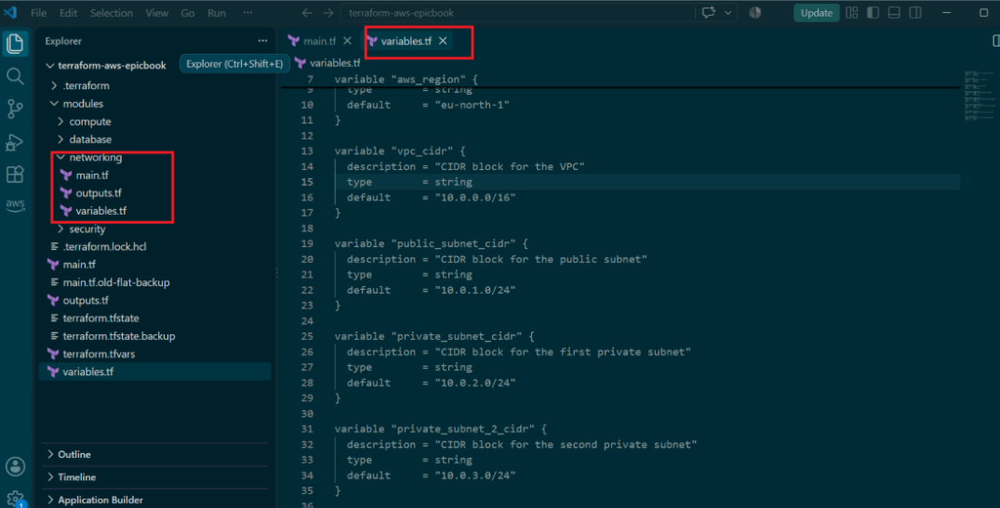

---

#### Screenshot 2 — Terraform configuration showing the Internet Gateway, public route table, and both Security Groups

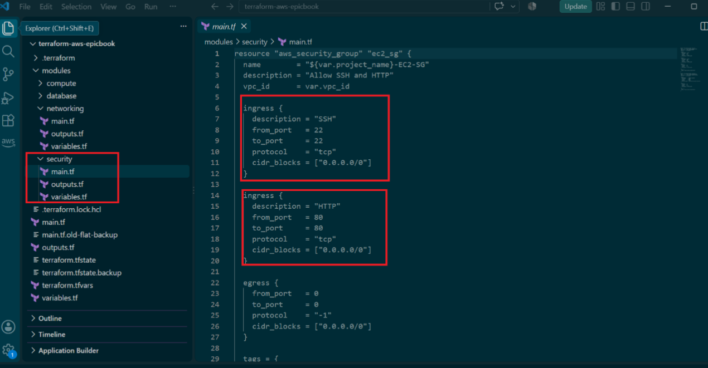

---

# Task 2 — Provision EC2 Virtual Machine (Ubuntu 22.04)

## Goal

Use Terraform to launch a t2.micro Ubuntu 22.04 EC2 instance in the public subnet with a public IP, then install Node.js, npm, Git, Nginx, and MySQL client.

### Evidence

#### Screenshot 3 — Terraform apply output showing successful EC2 provisioning

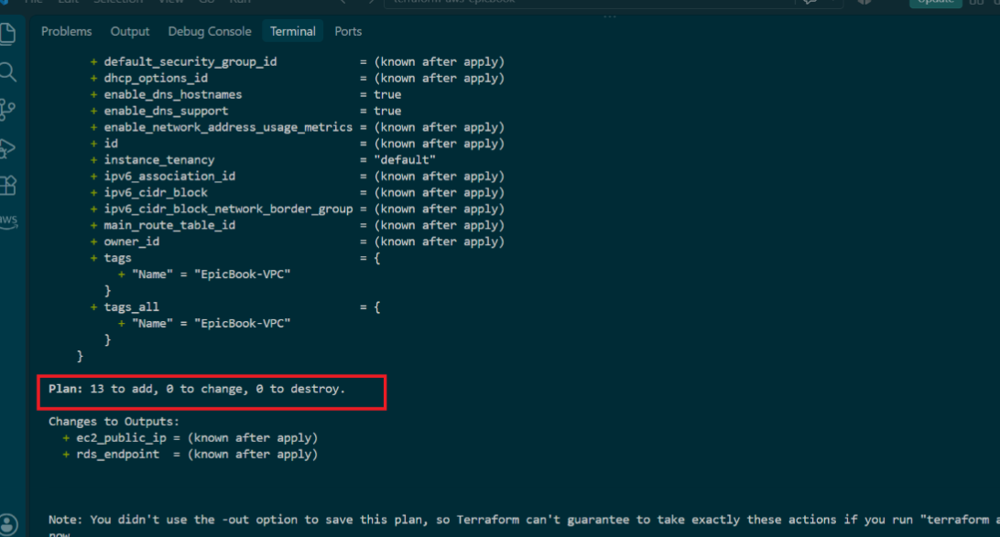

---

#### Screenshot 4 — EC2 instance running in the AWS Console with the public IP and subnet visible

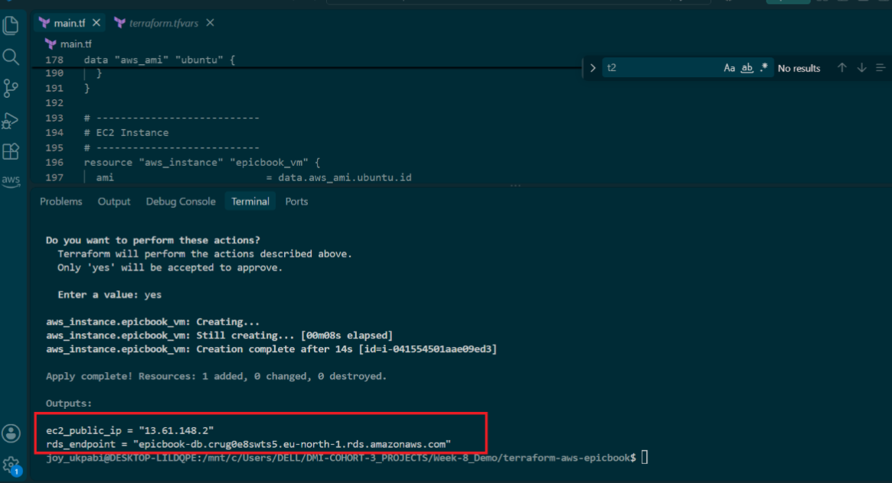

---

#### Screenshot 5 — Terminal showing successful SSH access and installed software

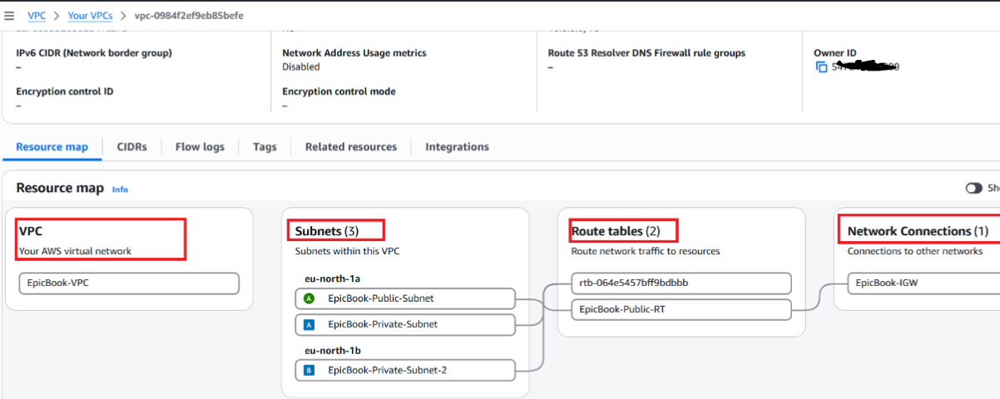

---

# Task 3 — Deploy the EpicBook Application

## Goal

Deploy the EpicBook frontend and backend on the EC2 instance and configure Nginx to serve it, following the Installation, Configuration & Troubleshooting Guide.

### Evidence

#### Screenshot 6 — Terminal showing the EpicBook application files and dependency installation

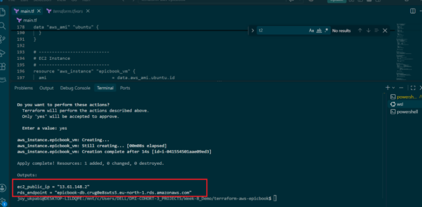

---

#### Screenshot 7 — Terminal showing the application and Nginx services running

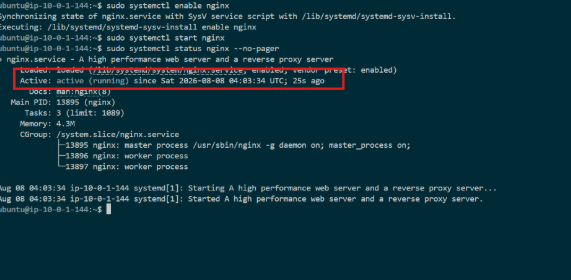

---

# Task 4 — Set Up Amazon RDS for MySQL with Terraform

## Goal

Provision a private Amazon RDS MySQL instance (db.t3.micro, Publicly accessible: false) restricted to the EC2 Security Group, then initialize the database using the provided SQL dump and connect the EpicBook backend to it.

### Evidence

#### Screenshot 8 — Terraform apply output showing successful RDS provisioning

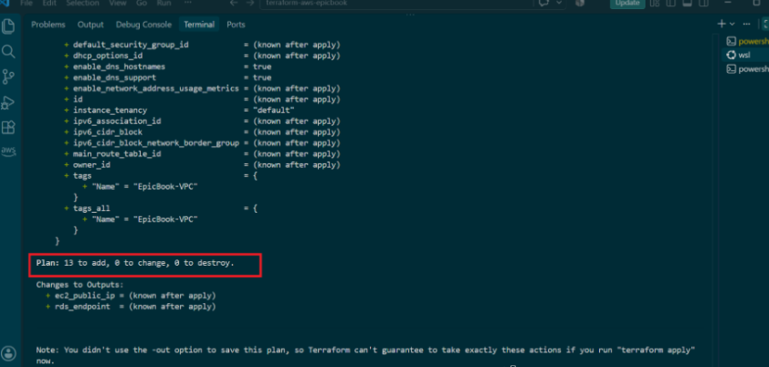

---

#### Screenshot 9 — RDS instance in the AWS Console showing the private network configuration and Publicly accessible: No

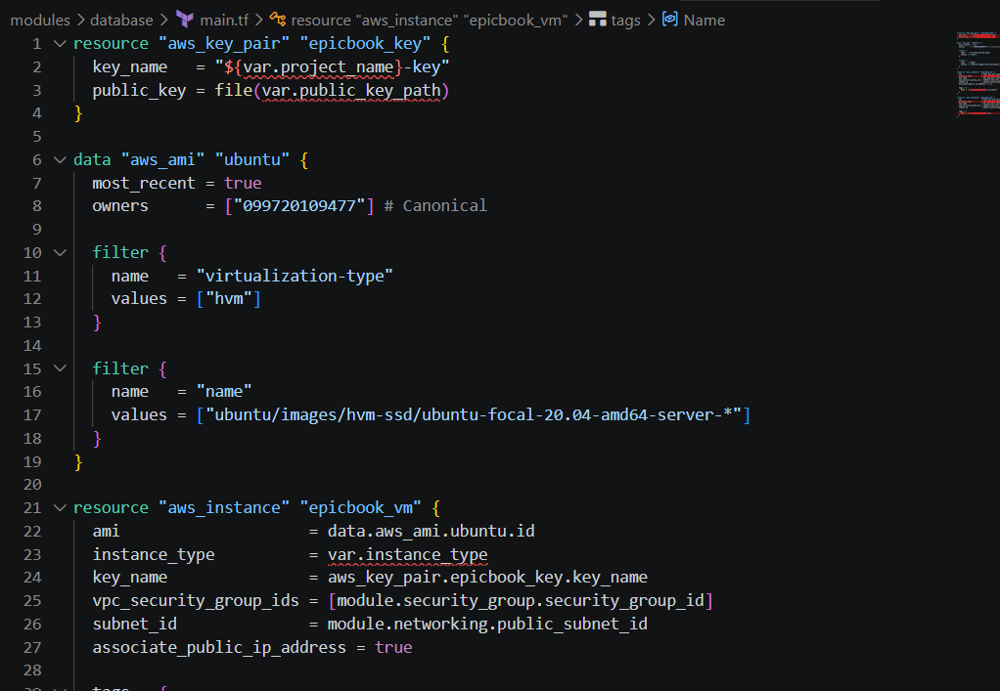

---

#### Screenshot 10 — Terminal showing successful database initialization or table verification from EC2

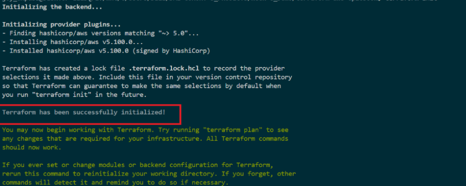

---

# Task 5 — Test End-to-End Functionality

## Goal

Confirm EpicBook is accessible through the EC2 public IP and that navigation, cart, order summary, and checkout all work against the MySQL backend.

### Evidence

#### Screenshot 11 — Browser showing the EpicBook application through the EC2 public IP

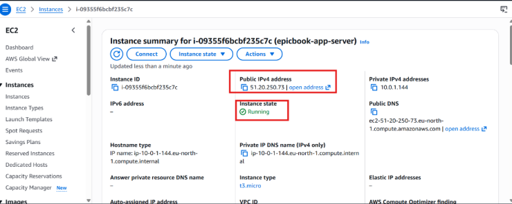

---

#### Screenshot 12 — Browser showing a working product, cart, order summary, or checkout flow

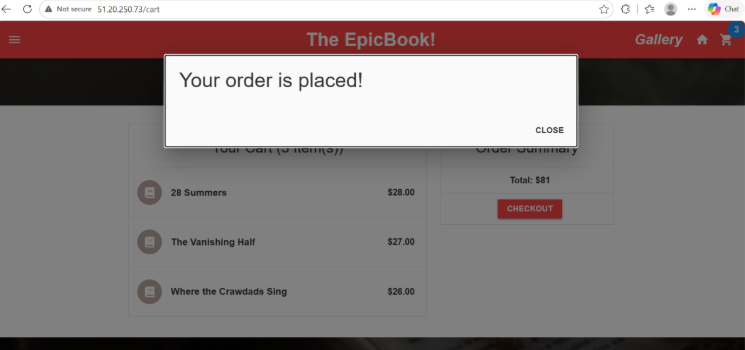

---

### Notes

Write a short note describing any issue you faced, how you fixed it, and what you learned.

During the deployment of the EpicBook application on an Amazon EC2 instance and the setup of Amazon RDS for MySQL using Terraform, I encountered a few infrastructure and configuration challenges. The main issues included Terraform state inconsistencies, SSH key path errors, security group configuration for EC2 and RDS connectivity, and application connectivity to the MySQL database. I resolved these by correcting the SSH public key path, updating Terraform configurations, verifying resource dependencies, configuring the EC2 and RDS security groups to allow the required traffic, and validating the database connection from the EC2 instance.

This deployment taught me the importance of proper Terraform state management, using reusable Infrastructure as Code configurations, understanding AWS networking and security group rules, and troubleshooting cloud infrastructure step by step. It also reinforced how EC2, RDS, networking, and Terraform work together to deploy a secure and functional cloud application.

---

# LinkedIn Post (Required)

## Goal

Publish a LinkedIn post about what you achieved in this assignment, with public or "Anyone" visibility.

## Evidence

#### LinkedIn Post URL

https://lnkd.in/p/e3URUjYT

---

#### Screenshot 13 — Published LinkedIn post showing the text and at least one image or proof

---

# Submission Instructions

- Add all required screenshots in your submission
- Include the EC2 public IP
- Do not expose database passwords, private keys, or other secrets

---

# Completion Checklist

- [✅] Task 1: VPC, subnets, IGW, and Security Groups created with Terraform (Screenshots 1–2)
- [✅] Task 2: EC2 provisioned and required software installed (Screenshots 3–5)
- [✅] Task 3: EpicBook deployed and Nginx serving the app (Screenshots 6–7)
- [✅] Task 4: Private RDS MySQL created and database initialized (Screenshots 8–10)
- [✅] Task 5: End-to-end functionality validated (Screenshots 11–12)
- [✅] Issue/fix/learning note written (Notes)
- [✅] LinkedIn post published and URL submitted (Screenshot 13)
- [✅] No sensitive data exposed

---

## 📌 About DMI & CloudAdvisory

DevOps Micro Internship (DMI) is a project-based DevOps program run by Pravin Mishra (The CloudAdvisory) focused on real-world execution, systems thinking, and career readiness.

It helps learners build strong DevOps foundations with hands-on experience.

---

## 📌 Resources

- 🌐 DMI Official Website: https://dmi.pravinmishra.com?utm_source=github&utm_medium=readme  
- 🎓 University: https://university.pravinmishra.com?utm_source=github&utm_medium=readme  
- 💬 Discord Community: https://discord.pravinmishra.com?utm_source=github&utm_medium=readme  
- 📝 Blog: https://dmi.pravinmishra.com/blog?utm_source=github&utm_medium=readme  
- ▶️ YouTube Playlist: https://www.youtube.com/playlist?list=PLFeSNDtI4Cho  
- 🔗 Pravin Mishra (LinkedIn): https://www.linkedin.com/in/pravin-mishra-aws-trainer/  
- 🏢 CloudAdvisory (LinkedIn): https://www.linkedin.com/company/thecloudadvisory/

---

*This submission is part of DevOps Micro Internship (DMI) Cohort 3 — Agentic AI Track.*
