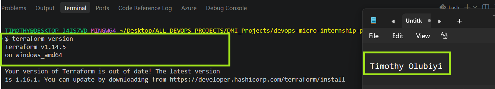
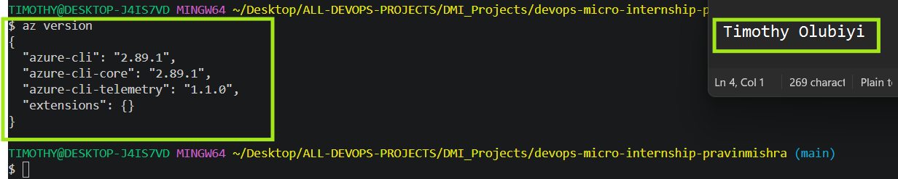
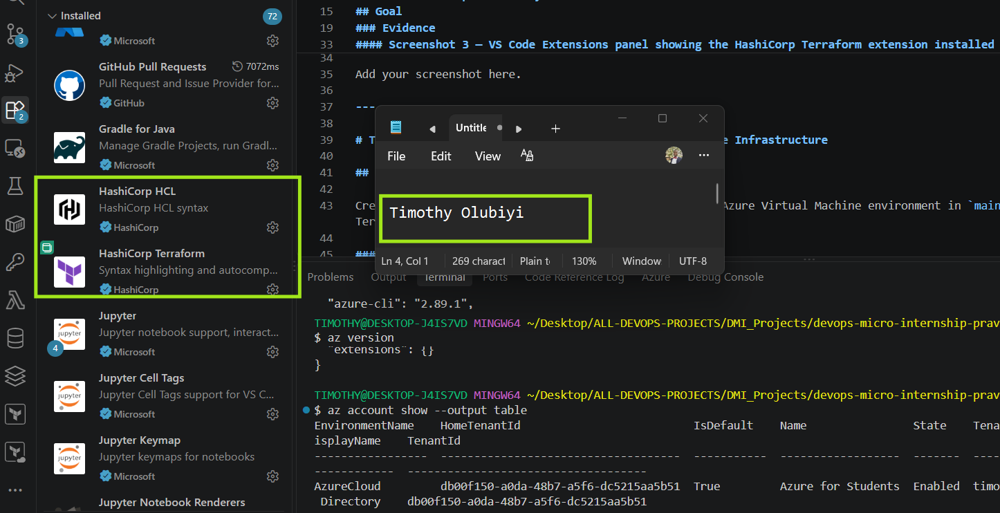
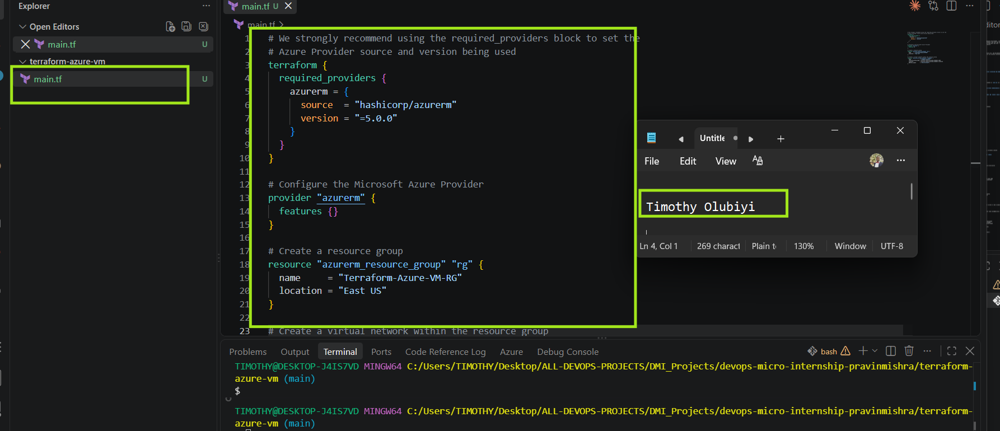
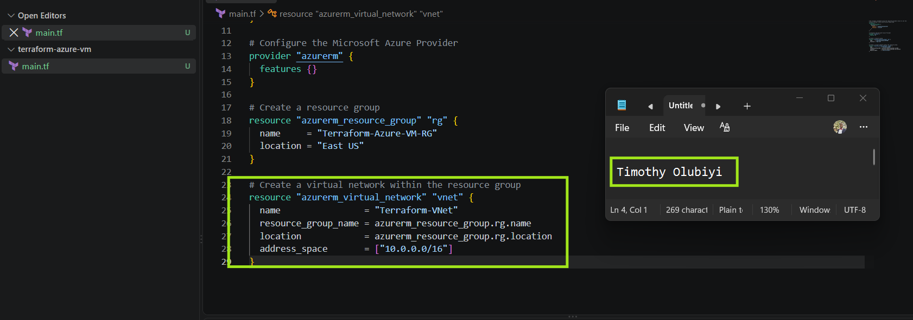
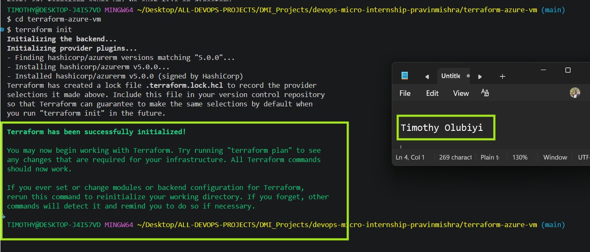
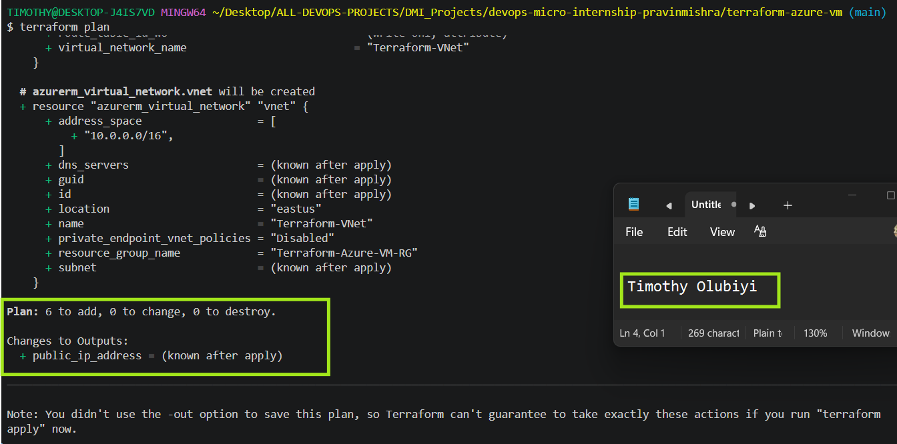
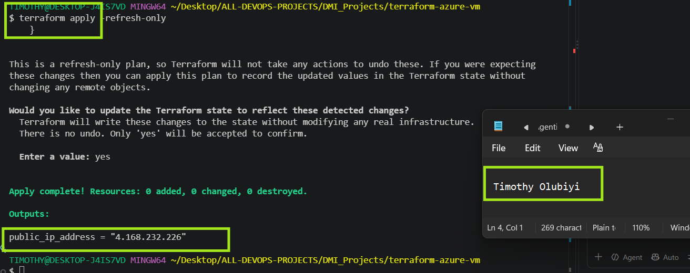
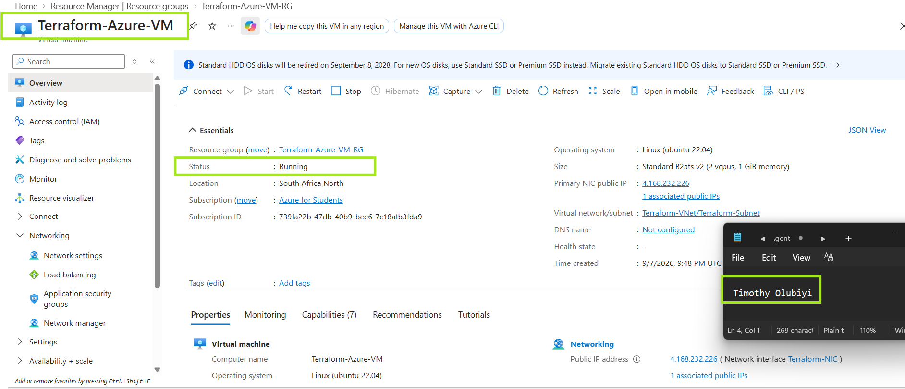

# Assignment 6 — AI-Assisted Terraform Drift and Policy Review

Part of the DevOps Micro Internship (DMI) with Agentic AI

---

## Student Details

**Full Name:** Timothy Olubiyi  
**GitHub Repository/Folder URL:** 

---

## Purpose

Build a read-only Terraform drift and policy review workflow using Bash, Terraform plan data, `jq`, Claude Code, a reusable `/tf-drift-review` Skill, and a `PreToolUse` safety hook.

The workflow must follow this pattern:

```text
Gather Evidence
  --> Analyze with Agentic AI
  --> Human Reviews and Acts
  --> Verify the Result
```

The `/tf-drift-review` Skill and `tf-drift-check.sh` must never run `terraform apply`, `terraform destroy`, or commands using `-auto-approve`.

---

# Task 1 — Confirm the Clean Baseline and Create the Workspace

## Goal

Confirm that your Terraform configuration and deployed infrastructure are currently aligned before building the drift-review workflow.

## Evidence

### Screenshot 1 — Clean Terraform Plan

Add a screenshot of `terraform plan` showing no pending changes.



---

### Screenshot 2 — Assignment Workspace

Add a screenshot of the folder structure showing `AI Assignment/`, `reports/`, and the Terraform project.



## Questions

### 1. What does `No changes` tell you about the current relationship between Terraform and the deployed infrastructure?


### 2. Why is a clean baseline important before introducing a test change?


---

# Task 2 — Create Project Context and Safety Rules in `CLAUDE.md`

## Goal

Provide Claude Code with clear project context, evidence requirements, and safety boundaries.

## Evidence

### Screenshot 3 — Project Context and Safety Rules

Add a screenshot of `CLAUDE.md` open in VS Code showing the Project Overview, Review Workflow, Safety Rules, and Output Rules.



## Questions

### 1. Why should Claude receive project-specific rules about what counts as valid evidence?


### 2. Why must the human remain responsible for running `terraform apply`?


### 3. Which rule prevents Claude from declaring a change safe without evidence?


---

# Task 3 — Build the Terraform Drift and Policy Check Script

## Goal

Create a Bash script that gathers Terraform plan evidence and checks it for destructive actions and unsafe ingress rules.

## Evidence

### Screenshot 4 — Script Variables and Checks Array

Add a screenshot of the top section of `tf-drift-check.sh` showing the variables and `checks` array.



---

### Screenshot 5 — Destructive-Action and Open-Ingress Checks

Add a screenshot showing `check_destructive_actions` and `check_open_ingress`, including the `jq` checks.


---

### Screenshot 6 — Script Validation and Permissions

Add a screenshot showing successful `bash -n` and `ls -l` output.

6

## Questions

### 1. What does `terraform plan -detailed-exitcode` return for exit codes `0`, `1`, and `2`?


### 2. Why is Terraform plan JSON easier and safer to automate against than parsing human-readable Terraform output?


### 3. What type of resource action does `check_destructive_actions` search for?


### 4. Why does finding a `delete` action also help detect replacements?


### 5. Why must this script never run `terraform apply`?


---

# Task 4 — Run the Script Against the Clean Baseline

## Goal

Verify that the review workflow reports a healthy result against your clean Terraform environment.

## Evidence

### Screenshot 7 — Healthy Baseline Report

Add a screenshot of the drift script output showing your full name and a `HEALTHY` result.


---

### Screenshot 8 — Baseline Script Exit Code

Add a screenshot showing the captured script exit code `0`.



## Questions

### 1. What is the Overall Status of your baseline?


### 2. Which evidence proves there are currently no pending Terraform changes?


### 3. Was `reports/tfplan.json` created? Explain why or why not.


---

# Task 5 — Create and Run the `/tf-drift-review` Claude Code Skill

## Goal

Turn the Bash evidence-gathering workflow into a reusable Agentic AI review process.

## Evidence

### Screenshot 9 — `/tf-drift-review` Skill Configuration

Add a screenshot of `SKILL.md` showing the frontmatter, allowed tools, and safety rules.



---

### Screenshot 10 — Clean Agentic AI Review

Add a screenshot of `/tf-drift-review` showing the clean `HEALTHY` result.


## Questions

### 1. Why does this Skill have `Bash`, `Read`, and `Grep`, but not `Write`?


### 2. Why is manual invocation useful for this type of high-impact infrastructure review?


### 3. Which part of the workflow is deterministic Bash automation?


### 4. Which part requires Claude's reasoning?


### 5. Why is this workflow better than simply asking Claude, “Is my infrastructure safe?”


---

# Task 6 — Introduce a Controlled Difference and Detect It

## Goal

Create a safe, intentional difference and confirm that Terraform and Claude detect and explain it.

## Evidence

### Screenshot 11 — Controlled Difference

Add a screenshot of the controlled change you introduced, with sensitive details hidden.



---

### Screenshot 12 — Detected Difference and Risk Assessment

Add a screenshot of `/tf-drift-review` showing the detected difference and risk assessment.



---

### Screenshot 13 — Detected Drift Report

Add a screenshot of `drift-detected-report.txt` showing your full name and the `WARN` or `FAIL` result.


## Questions

### 1. What change did you introduce?


### 2. Was it true infrastructure drift or a Terraform configuration change?


### 3. What Terraform plan evidence proves that a change is pending?


### 4. Was the action an update, deletion, replacement, or security-rule change?


### 5. What did Claude recommend?


### 6. Why should you review the recommendation before taking action?


---

# Task 7 — Add a `PreToolUse` Hook to Block Unsafe Apply Attempts

## Goal

Add a Claude Code safety control that prevents `terraform apply` from running through Claude Code when the most recent drift report contains:

```text
Overall Status: FAIL
```

## Evidence

### Screenshot 14 — `PreToolUse` Safety Hook

Add a screenshot of `.claude/settings.json` showing the `PreToolUse` safety hook.


---

### Screenshot 15 — Blocked Apply Attempt

Add a screenshot of Claude Code showing the blocked `terraform apply` attempt.


## Questions

### 1. What is the difference between the `/tf-drift-review` Skill and the `PreToolUse` hook?


### 2. Which component performs analysis?


### 3. Which component enforces the safety gate?


### 4. Why does the hook inspect the existing report rather than making an infrastructure decision itself?


### 5. Why is a deterministic guard useful for high-impact commands?


---

# Task 8 — Resolve the Difference and Verify the Final State

## Goal

Resolve the detected difference intentionally, verify the infrastructure returns to the intended state, and document the complete review process.

## Evidence

### Screenshot 16 — Human-Reviewed Resolution

Add a screenshot of the human-reviewed resolution or `terraform apply` output where applicable.


---

### Screenshot 17 — Final Healthy Review

Add a screenshot of the final `/tf-drift-review` showing `HEALTHY`.


---

### Screenshot 18 — Saved Reports

Add a screenshot of `ls -lah reports` showing both:

- `drift-detected-report.txt`
- `resolved-report.txt`


---

### Screenshot 19 — Drift Review Summary

Add a screenshot of `drift-review-summary.md` showing all required sections and your full name.


## Terraform Drift Review Summary

### 1. Change Introduced

Explain the controlled change you introduced.

State whether it was:

- True infrastructure drift, or
- A Terraform configuration change


### 2. Evidence Collected

Describe the Terraform plan evidence and affected resource.


### 3. Risk Assessment

Explain the risk identified by the Bash check and Claude Code.


### 4. Human-Approved Action

Explain the action you reviewed and executed manually.


### 5. Verification

Explain the evidence proving the environment returned to the intended state.


### 6. Safety Decision

Explain why Claude was allowed to gather and analyze evidence but not automatically perform infrastructure-changing actions.


### 7. Agentic Loop Mapping

Explain how your workflow followed:

```text
Gather --> Analyze --> Human Act --> Verify
```


## Questions

### 1. What action did you execute to resolve the difference?


### 2. Did you review `terraform plan` before taking action?


### 3. What evidence proves the environment is now aligned?


### 4. Why is a second drift review required after the fix?


### 5. What could go wrong if an AI agent automatically applied every detected Terraform change?


### 6. In one sentence, explain the difference between asking an AI chatbot “Is my infrastructure okay?” and using this evidence-based Agentic AI workflow.


---

# LinkedIn Post — Mandatory

## Goal

Publish a LinkedIn post in your own words describing:

- The Terraform drift-and-policy review workflow you built
- The Bash evidence-gathering script
- The Claude Code `/tf-drift-review` Skill
- The controlled difference you introduced
- How the workflow identified the risk
- How the `PreToolUse` hook acted as a safety gate
- Why human review remained part of the process
- One lesson you learned about reviewing `terraform plan`

Include a screenshot of the detected change and a screenshot of the final `HEALTHY` review in your post.

Suggested tags:

```text
#DMIByPravinMishra #Terraform #AgenticAI #ClaudeCode #DevOps
```

## LinkedIn Evidence

### LinkedIn Post URL


### Published LinkedIn Post Screenshot — Mandatory


---

# Required Assignment Files

Confirm that the following files are included in your GitHub repository:

- `CLAUDE.md`
- `AI Assignment/tf-drift-check.sh`
- `.claude/skills/tf-drift-review/SKILL.md`
- `.claude/settings.json` containing the safety hook
- `reports/drift-detected-report.txt`
- `reports/resolved-report.txt`
- `drift-review-summary.md`

---

# Submission Instructions

- Complete Tasks 1–8 in sequence.
- Include Screenshots 1–19 exactly as specified.
- Answer every question under Tasks 1–8 in your own words.
- Complete all seven sections of the Terraform Drift Review Summary.
- Include the GitHub repository/folder URL containing the assignment files.
- Include your full name in the required reports and screenshots.
- Include the LinkedIn post URL and a screenshot of the published LinkedIn post.
- Do not expose access keys, passwords, tokens, account IDs, private keys, Terraform secrets, or other sensitive information.
- Review all screenshots carefully and hide or redact sensitive details where necessary.

---

# Completion Checklist

- [✅] Confirmed a clean Terraform baseline
- [✅] Created the required assignment workspace
- [✅] Created or updated `CLAUDE.md`
- [✅] Added project context and safety rules
- [✅] Created `tf-drift-check.sh`
- [✅] Added my full name to the report
- [✅] Validated the Bash script
- [✅] Made the script executable
- [✅] Used `terraform plan -detailed-exitcode`
- [✅] Used Terraform plan JSON
- [✅] Used `jq` to inspect destructive actions
- [✅] Used `jq` to inspect unsafe ingress
- [✅] Confirmed the baseline returns `HEALTHY`
- [✅] Created `/tf-drift-review`
- [✅] Restricted the Skill to appropriate tools
- [✅] Confirmed the Skill remains read-only
- [✅] Confirmed the Skill never runs `terraform apply`
- [✅] Confirmed the Skill never runs `terraform destroy`
- [✅] Introduced a controlled detectable difference
- [✅] Correctly identified whether it was true drift or a configuration change
- [✅] Saved `drift-detected-report.txt`
- [✅] Added the `PreToolUse` safety hook
- [✅] Verified the hook blocks `terraform apply` when the report is `FAIL`
- [✅] Reviewed the Terraform evidence before resolving the change
- [✅] Performed any infrastructure-changing action manually
- [✅] Ran the drift review again after resolution
- [✅] Confirmed the final status is `HEALTHY`
- [✅] Saved `resolved-report.txt`
- [✅] Completed `drift-review-summary.md`
- [✅] Mapped the workflow to `Gather --> Analyze --> Human Act --> Verify`
- [✅] Included all 19 numbered screenshots
- [✅] Answered all required questions
- [✅] Published the required LinkedIn post
- [✅] Added the LinkedIn post URL and screenshot
- [✅] Included the GitHub repository/folder URL
- [✅] Confirmed that no sensitive information is exposed

---

*This submission is part of the DevOps Micro Internship (DMI) Cohort 3 — Agentic AI Track.*
