# Assignment 03 — Deploy a Static Website to Multiple Servers Using a Multi-Play Ansible Playbook

Part of the DevOps Micro Internship (DMI) with Agentic AI

---

## Student Details

**Full Name:** Add your full name here  
**Cloud Platform Used:** AWS / Azure  
**Server 1 URL:** `http://<SERVER_1_PUBLIC_IP>`  
**Server 2 URL:** `http://<SERVER_2_PUBLIC_IP>`

---

## Purpose

In this assignment, you will create a multi-play Ansible playbook to install Nginx, deploy a static website to two Ubuntu servers, and verify that the website is accessible from both servers.

You may use either AWS EC2 instances or Azure Virtual Machines as your managed servers.

---

# Task 1 — Create the Project Structure

## Goal

Create the required folders and files for the Ansible project.

## Evidence

### Screenshot 1 — Terminal or VS Code showing the complete `static-web` project structure

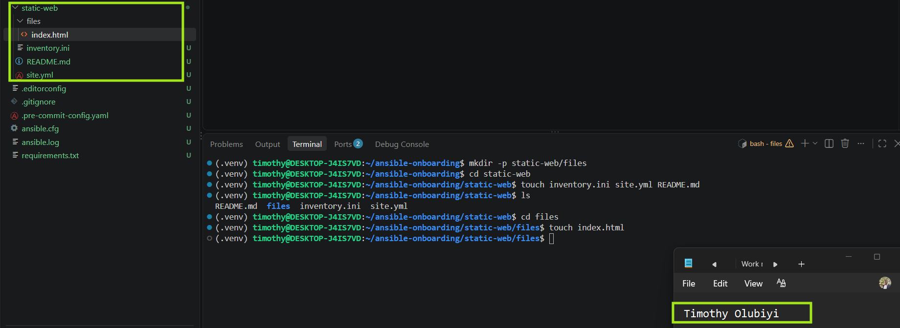

---

# Task 2 — Configure the Ansible Inventory

## Goal

Add both Ubuntu servers to the Ansible inventory.

## Evidence

### Screenshot 2 — Output of `ansible-inventory -i inventory.ini --graph` showing `web1` and `web2`

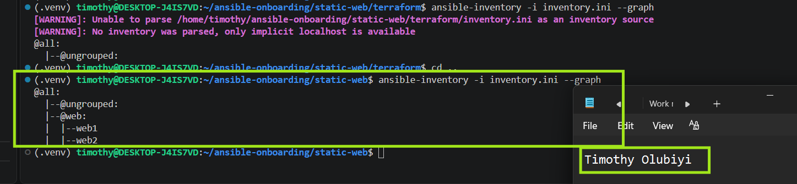

---

## Configuration File

Copy and paste the complete contents of your `inventory.ini` file below:

[web]
web1 ansible_host=20.87.25.22
web2 ansible_host=20.87.211.62


[all:vars]
ansible_user=azureuser
ansible_ssh_private_key_file=/home/timothy/.ssh/id_rsa


---

# Task 3 — Verify Ansible Connectivity

## Goal

Confirm that the Ansible controller can connect to both servers.

## Evidence

### Screenshot 3 — Ansible ping output showing `SUCCESS` and `pong` for both servers

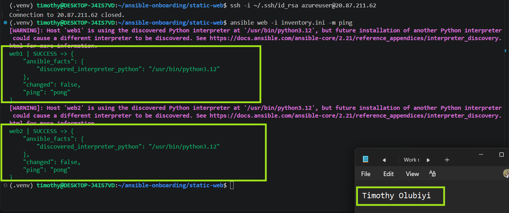

---

# Task 4 — Download and Personalize the Static Website

## Goal

Download `index.html` to the Ansible controller and personalize the website with your full name.

## Evidence

### Screenshot 4 — Edited `files/index.html` showing the footer line with your full name

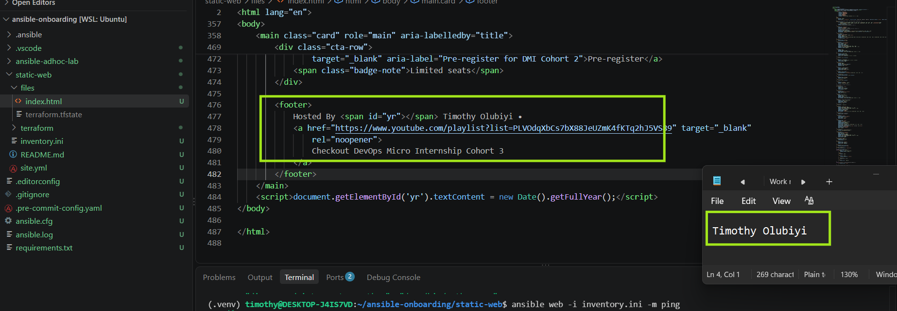


---

# Task 5 — Create the Multi-Play Ansible Playbook

## Goal

Create a single Ansible playbook containing separate plays for installation, deployment, and verification.

## Configuration File

Copy and paste the complete contents of your `site.yml` file below:

---
# Play 1 — Install and configure Nginx
- name: Install and configure Nginx
  hosts: web
  become: true

  tasks:
    - name: Update APT package cache
      ansible.builtin.apt:
        update_cache: true

    - name: Install Nginx
      ansible.builtin.apt:
        name: nginx
        state: present

    - name: Start and enable Nginx
      ansible.builtin.service:
        name: nginx
        state: started
        enabled: true


# Play 2 — Deploy the static website
- name: Deploy static website
  hosts: web
  become: true

  tasks:
    - name: Deploy website index.html
      ansible.builtin.copy:
        src: files/index.html
        dest: /var/www/html/index.html
        owner: www-data
        group: www-data
        mode: "0644"
      notify: Reload Nginx

  handlers:
    - name: Reload Nginx
      ansible.builtin.service:
        name: nginx
        state: reloaded


# Play 3 — Verify both websites from the controller
- name: Verify websites from Ansible controller
  hosts: localhost
  connection: local
  gather_facts: false
  become: false

  tasks:
    - name: Check website availability
      ansible.builtin.uri:
        url: "http://{{ hostvars[item].ansible_host }}"
        method: GET
        status_code: 200
      loop: "{{ groups['web'] }}"
      register: website_checks

    - name: Verify website HTTP status
      ansible.builtin.assert:
        that:
          - item.status == 200
        success_msg: "{{ item.item }} is accessible with HTTP status {{ item.status }}"
        fail_msg: "{{ item.item }} verification failed with HTTP status {{ item.status }}"
      loop: "{{ website_checks.results }}"

---

# Task 6 — Validate the Playbook Syntax

## Goal

Check the playbook for YAML or Ansible syntax errors before running it.

## Evidence

### Screenshot 5 — Successful syntax-check output showing `playbook: site.yml`

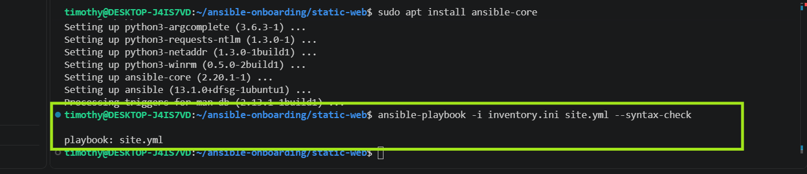

---

# Task 7 — Run the Multi-Play Playbook

## Goal

Install Nginx, deploy the website, and verify both servers in one playbook run.

## Evidence

### Screenshot 6 — Play 3 verification showing HTTP `200` for both servers

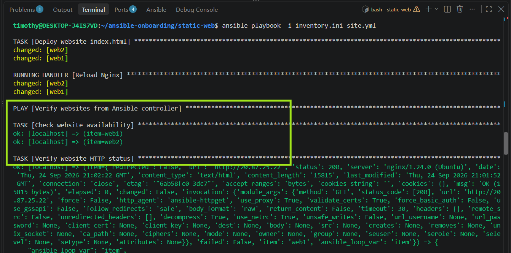

---

### Screenshot 7 — Final play recap showing `unreachable=0` and `failed=0` for `web1`, `web2`, and `localhost`

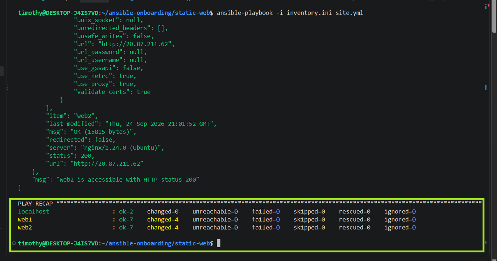

---

# Task 8 — Verify Idempotency

## Goal

Run the playbook again and confirm that it does not make unnecessary changes.

## Evidence

### Screenshot 8 — Second playbook run showing the play recap with `changed=0`, `unreachable=0`, and `failed=0` for both web servers

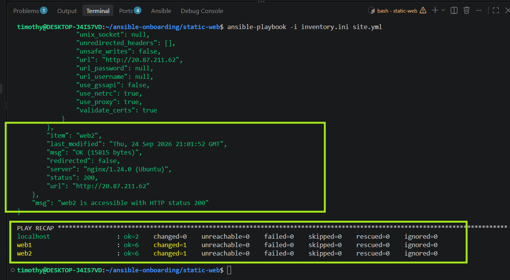

---

# Task 9 — Test Both Websites Manually

## Goal

Confirm that the static website is accessible from both public IP addresses.

## Evidence

### Screenshot 9 — `curl -I` output showing HTTP `200 OK` from both servers

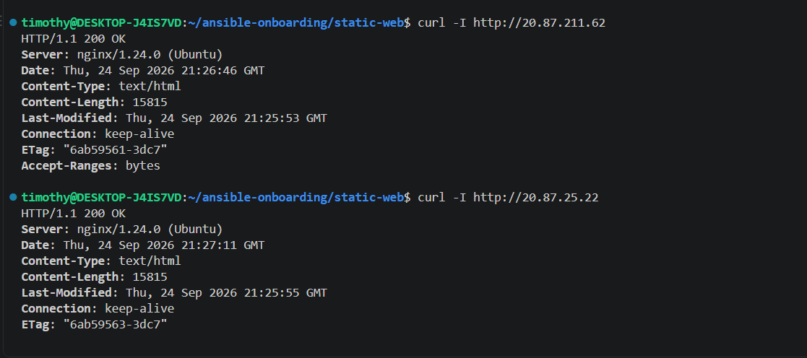

---

### Screenshot 10 — Browser showing the website from Server 1 with the public IP and your full name visible

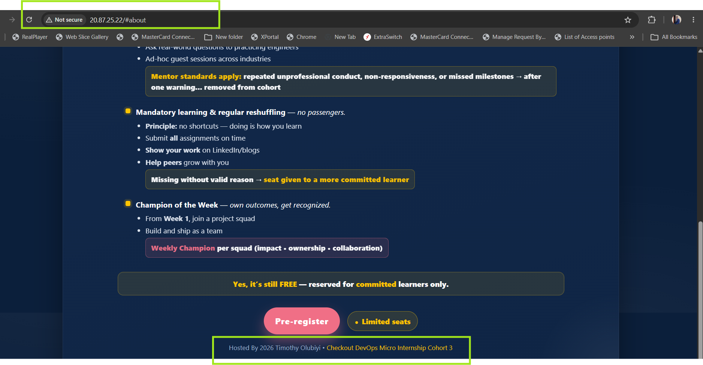

---

### Screenshot 11 — Browser showing the website from Server 2 with the public IP and your full name visible

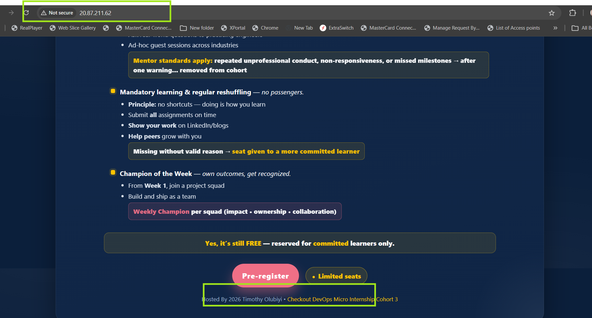

---

## Website URLs

Add both deployed website URLs below:

```text
Server 1: http://20.87.211.62
Server 2: http://20.87.25.22
```

---

# Task 10 — Complete the Project README

## Goal

Document how the project works and record what you learned.

## README Content

Copy and paste the complete contents of your `README.md` file below:

# Multi-Play Ansible Static Website Deployment
 
## Project Overview
 
Briefly explain what you deployed.
 
## Environment
 
- Cloud platform:
- Operating system:
- Number of managed servers:
- Web server:
 
## How to Run the Playbook
 
Add the command used to run the playbook.
 
## Issue Faced and Solution
 
Describe an issue you encountered and explain how you fixed it.
 
## What I Learned
 
Explain what you learned from this assignment.
 
## Why Installation and Deployment Are Separate
 
Explain why installing Nginx and deploying website content are handled in separate plays.
 
## Benefit of the Ansible Copy Module
 
Explain one benefit of using the Ansible copy module instead of cloning the website directly from Git on every managed server.

---

# LinkedIn Post Required

## Evidence

### LinkedIn Post URL

Paste your LinkedIn post URL here:


---

### Screenshot — Published LinkedIn post


---

# Assignment Questions

Answer the following in your own words:

**1. What issue did you face while completing this assignment, and how did you fix it?**

One issue I faced while completing the assignment was an SSH configuration error that prevented Ansible from connecting to the Azure web server. The problem was caused by a typo in the SSH configuration file, where IdentifyFile was used instead of the correct IdentityFile directive. I identified the error from the Ansible connection output, corrected the SSH configuration, verified the connection, and ensured that the inventory referenced the correct private SSH key. After making these changes, I successfully connected to the managed host and proceeded with the Nginx installation, website deployment, and HTTP verification tasks.

---

**2. What did you learn from this assignment?**

I learned how to use Ansible to automate the installation, configuration, deployment, and verification of a web server in a cloud environment. The assignment strengthened my understanding of Ansible inventories, privilege escalation, fully qualified module names, handlers, loops, variables, and HTTP validation using the uri and assert modules. I also learned the importance of troubleshooting SSH connectivity and configuration issues when managing remote servers. Overall, the assignment demonstrated how Ansible can make infrastructure management repeatable, consistent, and efficient across multiple servers.

---

**3. Why is it useful to split installation, deployment, and verification into separate plays?**

Splitting installation, deployment, and verification into separate plays makes the Ansible automation more organized, maintainable, and easier to troubleshoot. Each play has a specific responsibility: the first prepares the server and installs Nginx, the second deploys the application content, and the third verifies that the deployed websites are accessible and returning the expected HTTP status. This separation also makes it easier to identify where a failure occurs, reuse individual plays when needed, and follow a clear provision → deploy → verify workflow.

---

**4. What is one benefit of using the Ansible `copy` module instead of cloning the website directly from Git on every managed server?**

One benefit of using the Ansible copy module is that it provides centralized and consistent deployment of the website from the Ansible controller to all managed servers. Instead of requiring Git and repository access on every server, Ansible directly copies the approved index.html file and can also enforce the required owner, group, and file permissions. This makes the deployment simpler, controlled, and repeatable.

---

**5. What does idempotency mean in this assignment?**

Idempotency means that running the same Ansible playbook multiple times produces the same desired state without unnecessarily changing resources that are already correctly configured. In this assignment, for example, Nginx remains installed and running, the website file is only updated when its content changes, and the service is not unnecessarily restarted. This makes the automation safe, predictable, repeatable, and efficient.

---

**6. What does the Ansible `uri` module verify in Play 3?**

The Ansible uri module in Play 3 verifies that each web server is accessible over HTTP from the Ansible controller and returns the expected HTTP status code 200. It sends a GET request to each web server's public IP address and records the response in the website_checks variable. The subsequent assert task checks the returned status value to confirm that each website is responding successfully.
---

# Required Files

Confirm that the following files are included in your assignment folder:

- [✅] `inventory.ini`
- [✅] `site.yml`
- [✅] `files/index.html`
- [✅] `README.md`

---

# Submission Instructions

- Add all required screenshots in the correct order.
- Full Name must be visible in required screenshots.
- Include both deployed website URLs.
- Paste `inventory.ini`, `site.yml`, and `README.md` as editable text.
- Answer all assignment questions clearly in your own words.
- Add your LinkedIn post URL.
- Do not expose SSH private keys, passwords, cloud account IDs, or other sensitive information.

---

# Completion Checklist

- [✅] Task 1: `static-web` folder structure is complete
- [✅] Task 2: Both servers are listed under the `[web]` group in `inventory.ini`
- [✅] Task 2: Inventory graph shows `web1` and `web2`
- [✅] Task 3: Ansible ping returns `SUCCESS` and `pong` for both servers
- [✅] Task 4: `files/index.html` contains your full name
- [✅] Task 5: `site.yml` contains three separate plays
- [✅] Task 5: Play 1 installs, starts, and enables Nginx
- [✅] Task 5: Play 2 deploys `index.html` using the `copy` module
- [✅] Task 5: Nginx reload handler is included
- [✅] Task 5: Play 3 verifies both web servers from the controller
- [✅] Task 6: Playbook syntax check passes
- [✅] Task 7: First playbook run completes with `unreachable=0` and `failed=0`
- [✅] Task 7: URI verification returns HTTP `200` for both servers
- [✅] Task 8: Second playbook run demonstrates idempotency
- [✅] Task 8: Second run shows `changed=0` for both web servers
- [✅] Task 9: Both `curl -I` commands return HTTP `200 OK`
- [✅] Task 9: Website loads from Server 1
- [✅] Task 9: Website loads from Server 2
- [✅] Task 9: Full name is visible on both deployed websites
- [✅] Task 10: `README.md` contains all required explanations
- [✅] Screenshots 1–11 are included
- [✅] `inventory.ini`, `site.yml`, and `README.md` are pasted as editable text
- [✅] Both website URLs are included
- [✅] Assignment questions are answered
- [✅] LinkedIn post published
- [✅] LinkedIn post URL added
- [✅] No sensitive information is exposed

---

## About DMI & CloudAdvisory

DevOps Micro Internship (DMI) is a project-based DevOps program run by Pravin Mishra and The CloudAdvisory, focused on real-world execution, systems thinking, and career readiness.

It helps learners build strong DevOps foundations with hands-on experience.

---

## Resources

- DMI Official Website: [https://dmi.pravinmishra.com?utm_source=github&utm_medium=readme](https://dmi.pravinmishra.com?utm_source=github&utm_medium=readme)
- University: [https://university.pravinmishra.com?utm_source=github&utm_medium=readme](https://university.pravinmishra.com?utm_source=github&utm_medium=readme)
- Discord Community: [https://discord.pravinmishra.com?utm_source=github&utm_medium=readme](https://discord.pravinmishra.com?utm_source=github&utm_medium=readme)
- Blog: [https://dmi.pravinmishra.com/blog?utm_source=github&utm_medium=readme](https://dmi.pravinmishra.com/blog?utm_source=github&utm_medium=readme)
- YouTube Playlist: [https://www.youtube.com/playlist?list=PLFeSNDtI4Cho](https://www.youtube.com/playlist?list=PLFeSNDtI4Cho)
- Pravin Mishra LinkedIn: [https://www.linkedin.com/in/pravin-mishra-aws-trainer/](https://www.linkedin.com/in/pravin-mishra-aws-trainer/)
- CloudAdvisory LinkedIn: [https://www.linkedin.com/company/thecloudadvisory/](https://www.linkedin.com/company/thecloudadvisory/)

---

*This submission is part of DevOps Micro Internship (DMI) — Agentic AI Track.*