# Assignment 04 — Deploy Mini Finance on Azure Using Terraform and Ansible

Part of the DevOps Micro Internship (DMI) with Agentic AI

---

## Purpose

In this assignment, you will provision Azure infrastructure using Terraform and deploy the Mini Finance website using an Ansible multi-play playbook.

Terraform will create the Azure Virtual Machine and networking resources. Ansible will install Nginx, clone the Mini Finance repository, deploy the website, and verify the deployment.

---

# Task 1 — Create the Project Structure

## Goal

Create separate directories and files for the Terraform infrastructure and Ansible configuration.

### Evidence

#### Screenshot 1 — Terminal or VS Code showing the complete `mini-finance` project structure

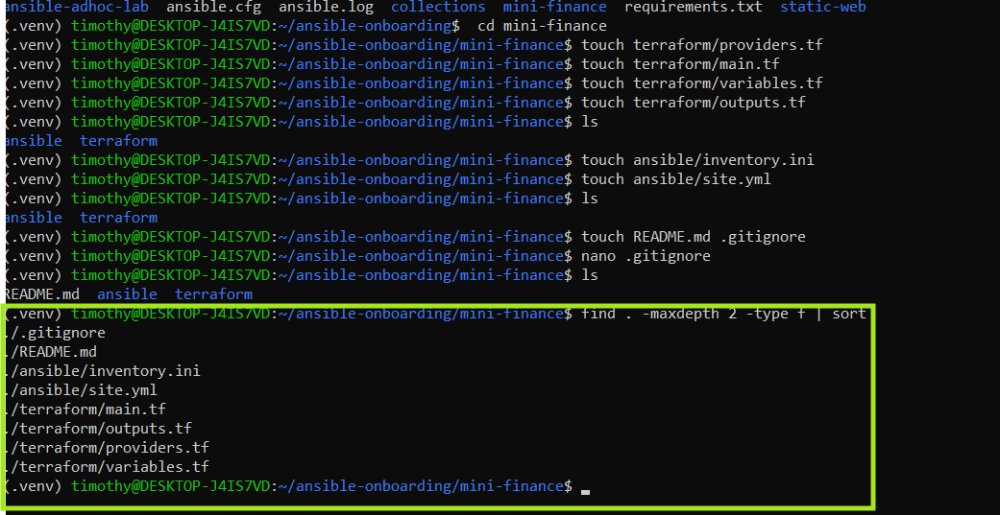

---

### Notes


---

# Task 2 — Create the Azure Infrastructure Using Terraform

## Goal

Use Terraform to provision an Ubuntu Virtual Machine with the required Azure networking and security resources.

### Evidence

#### Screenshot 2 — Terraform code showing the `Allow-SSH` rule for port `22` and the `Allow-HTTP` rule for port `80`

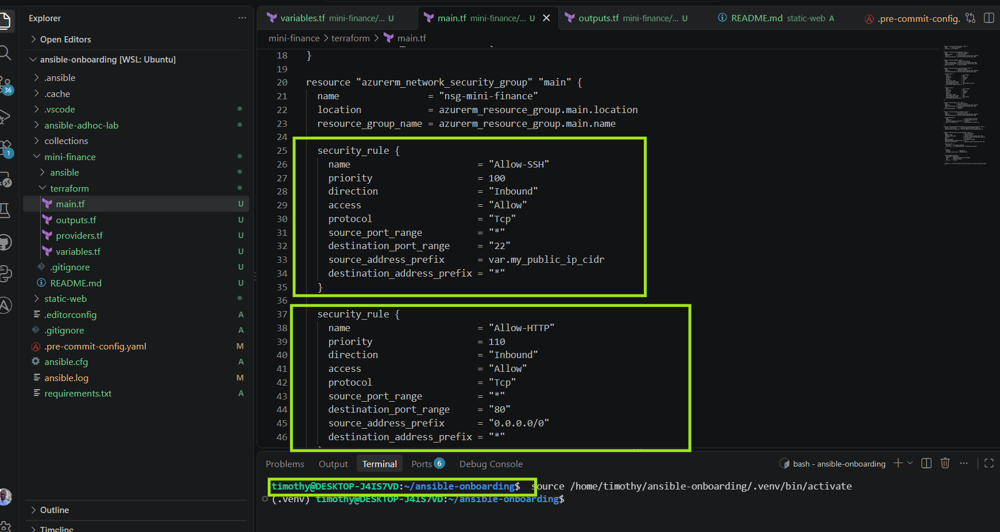

---

#### Screenshot 3 — Terraform code showing the association between `nsg-mini-finance` and `nic-mini-finance`

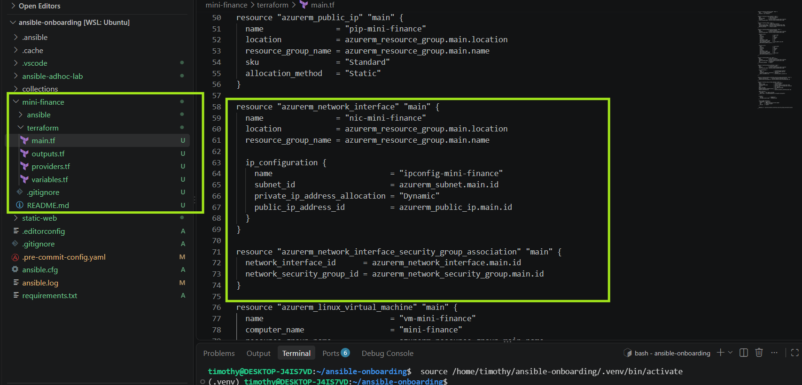

---

### Notes


---

# Task 3 — Initialize and Apply the Terraform Configuration

## Goal

Format and validate the Terraform configuration, review the execution plan, and provision the Azure infrastructure.

### Evidence

#### Screenshot 4 — End of the `terraform apply` output showing `Apply complete!` with no errors

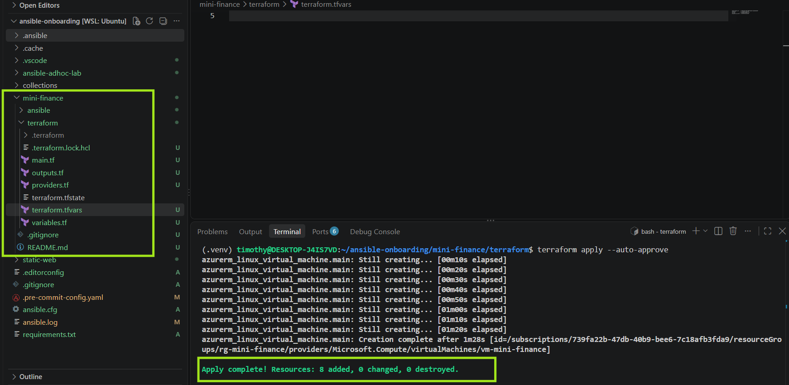

---

#### Screenshot 5 — Output of `terraform output public_ip` showing the VM’s public IP address

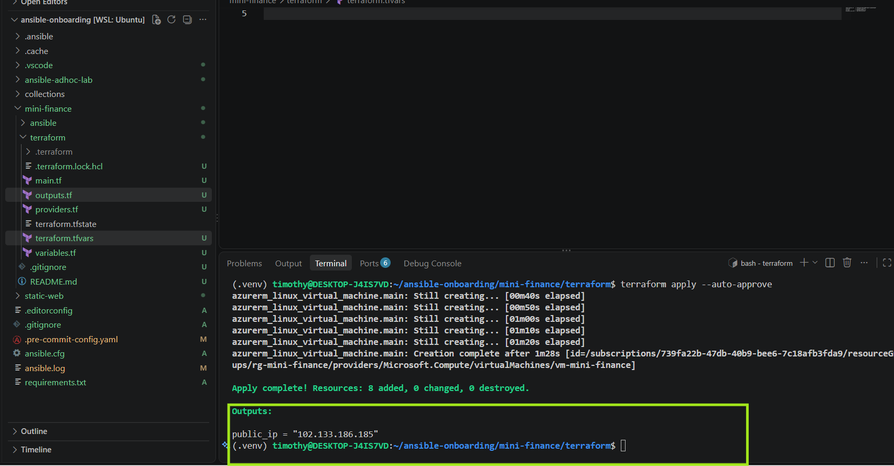

---

### Notes


---

# Task 4 — Verify Passwordless SSH Access

## Goal

Confirm that the Ansible controller can connect to the Terraform-provisioned Azure VM using SSH key authentication.

### Evidence

#### Screenshot 6 — Passwordless SSH command and the returned `mini-finance` hostname

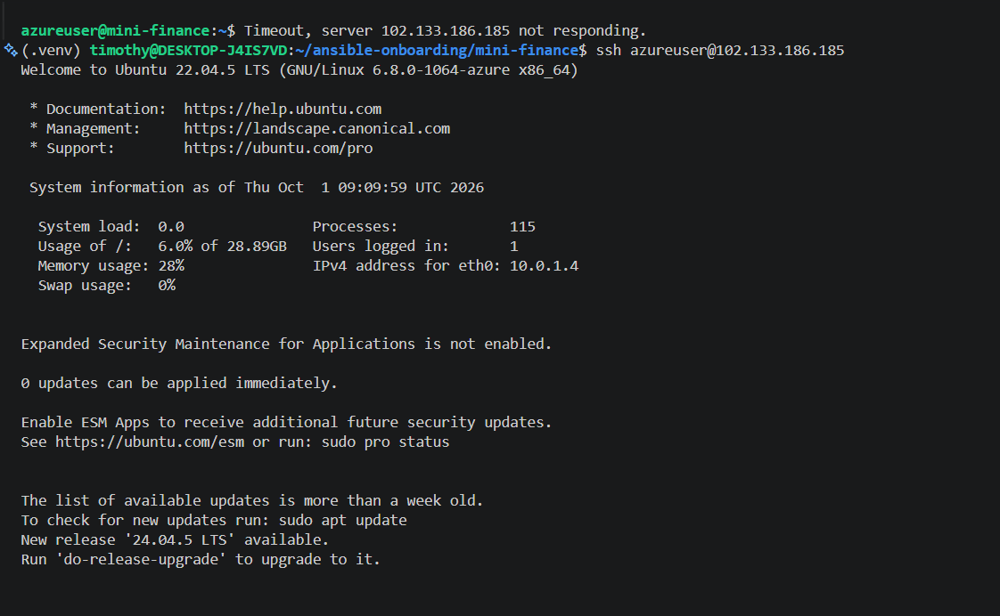

---

### Notes


---

# Task 5 — Create the Ansible Inventory and Verify Connectivity

## Goal

Add the Terraform-provisioned Azure VM to the Ansible inventory and confirm that Ansible can connect to it.

### Evidence

#### Screenshot 7 — Ansible ping output showing `SUCCESS` and `pong` from the Azure VM

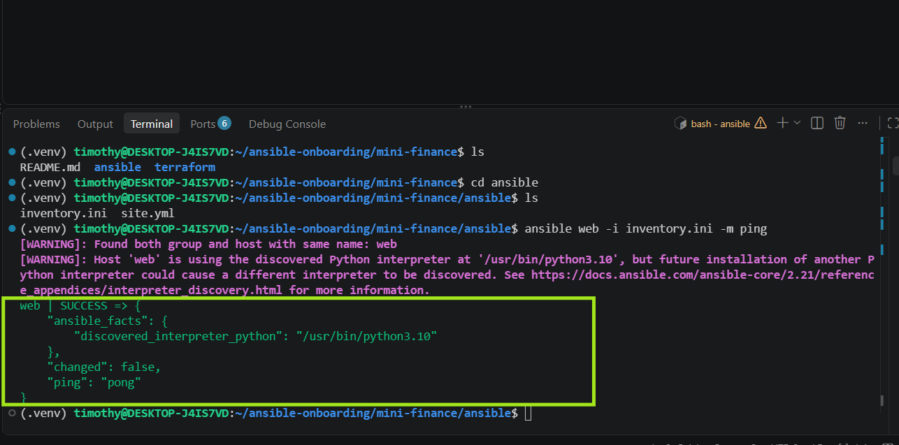

---

### Configuration File

Copy and paste the complete contents of your `ansible/inventory.ini` file below:

[web]
web ansible_host=102.133.186.185

[all:vars]
ansible_user=azureuser
ansible_ssh_private_key_file=/home/timothy/.ssh/id_rsa


---

# Task 6 — Create the Multi-Play Ansible Playbook

## Goal

Create one Ansible playbook containing separate plays to install Nginx, deploy the Mini Finance website, and verify the deployment.

### Evidence

#### Screenshot 8 — `site.yml` showing Play 1 and the beginning of Play 2

Screenshot must show:

- Play 1 targeting the `web` group
- Installation of `nginx`, `git`, and `rsync`
- Nginx service configured as started and enabled
- Beginning of Play 2 with the Git repository URL and synchronization task

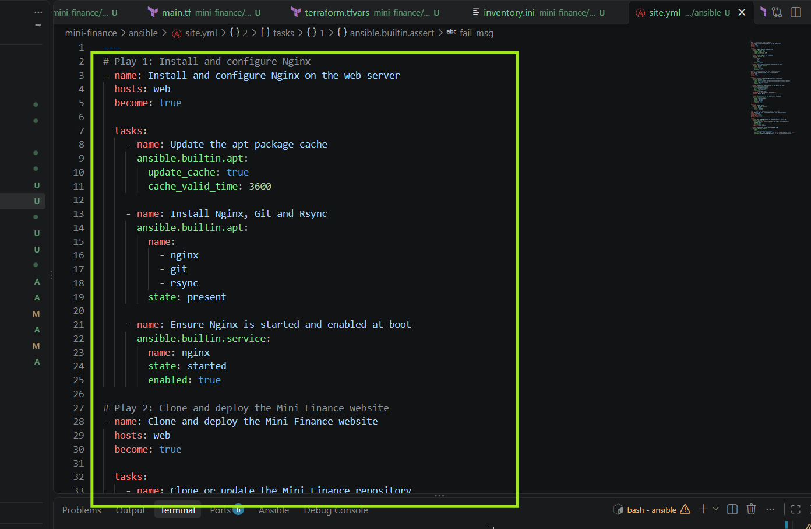

---

#### Screenshot 9 — `site.yml` showing the deployment destination, handler, and Play 3 verification

Screenshot must show:

- Website destination `/var/www/html/`
- Ownership set to `www-data:www-data`
- Nginx reload handler
- Play 3 targeting `localhost`
- The `uri` verification and `assert` condition

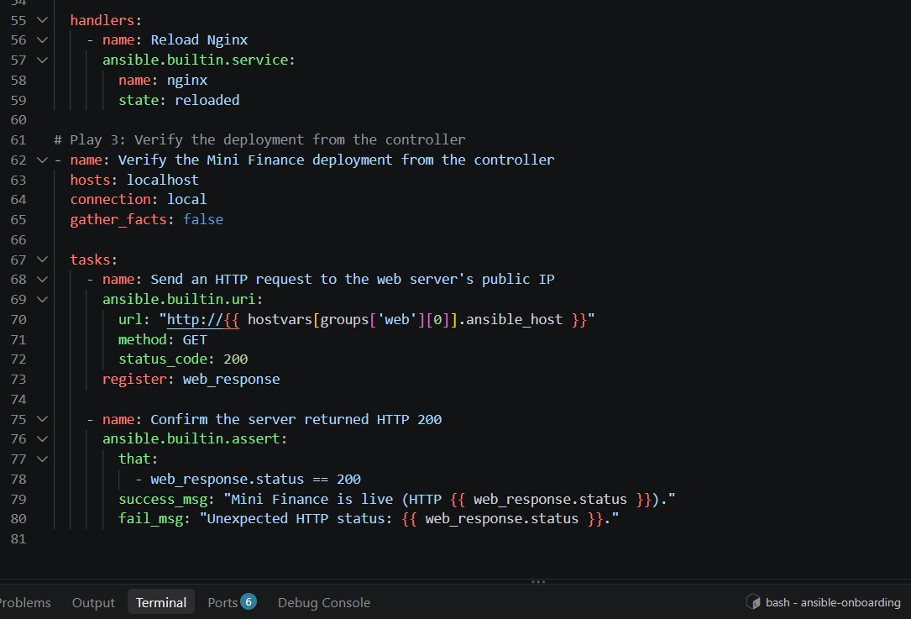

---

### Configuration File

Copy and paste the complete contents of your `ansible/site.yml` file below:

---
# Play 1: Install and configure Nginx
- name: Install and configure Nginx on the web server
  hosts: web
  become: true

  tasks:
    - name: Update the apt package cache
      ansible.builtin.apt:
        update_cache: true
        cache_valid_time: 3600

    - name: Install Nginx, Git and Rsync
      ansible.builtin.apt:
        name:
          - nginx
          - git
          - rsync
        state: present

    - name: Ensure Nginx is started and enabled at boot
      ansible.builtin.service:
        name: nginx
        state: started
        enabled: true

# Play 2: Clone and deploy the Mini Finance website
- name: Clone and deploy the Mini Finance website
  hosts: web
  become: true

  tasks:
    - name: Clone or update the Mini Finance repository
      ansible.builtin.git:
        repo: https://github.com/pravinmishraaws/mini-finance-project
        dest: /opt/mini-finance
        update: true

    - name: Synchronize website files to the Nginx web root
      ansible.posix.synchronize:
        src: /opt/mini-finance/
        dest: /var/www/html/
        rsync_opts:
          - "--exclude=.git"
      delegate_to: "{{ inventory_hostname }}"
      notify: Reload Nginx

    - name: Set ownership of the web root to www-data
      ansible.builtin.file:
        path: /var/www/html/
        owner: www-data
        group: www-data
        recurse: true

  handlers:
    - name: Reload Nginx
      ansible.builtin.service:
        name: nginx
        state: reloaded

# Play 3: Verify the deployment from the controller
- name: Verify the Mini Finance deployment from the controller
  hosts: localhost
  connection: local
  gather_facts: false

  tasks:
    - name: Send an HTTP request to the web server's public IP
      ansible.builtin.uri:
        url: "http://{{ hostvars[groups['web'][0]].ansible_host }}"
        method: GET
        status_code: 200
      register: web_response

    - name: Confirm the server returned HTTP 200
      ansible.builtin.assert:
        that:
          - web_response.status == 200
        success_msg: "Mini Finance is live (HTTP {{ web_response.status }})."
        fail_msg: "Unexpected HTTP status: {{ web_response.status }}."


---

# Task 7 — Validate and Run the Ansible Playbook

## Goal

Validate the syntax of the multi-play Ansible playbook and run it to install Nginx, deploy the Mini Finance website, and verify the deployment.

### Evidence

#### Screenshot 10 — Successful playbook syntax check showing `playbook: site.yml`

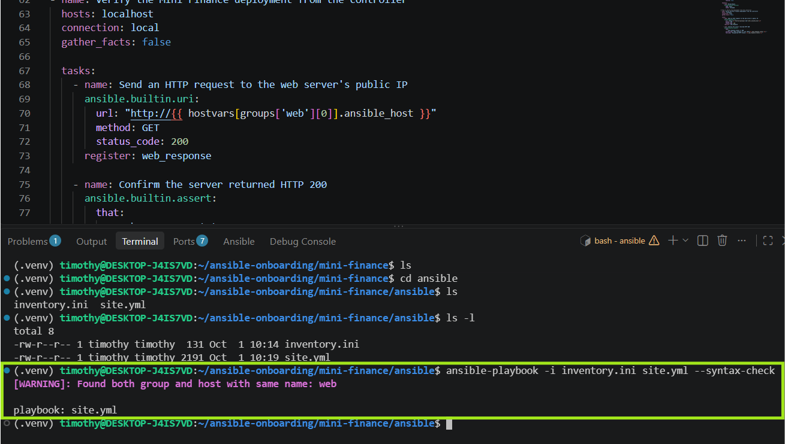

---

#### Screenshot 11 — Play 3 output showing the successful HTTP verification and assertion

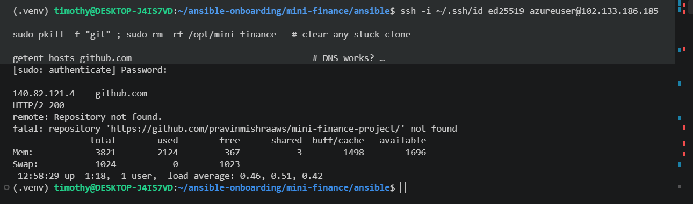

---

#### Screenshot 12 — Final `PLAY RECAP` showing `failed=0` and `unreachable=0`

Add your screenshot here.

---

### Notes

Add your task notes here.

---

# Task 8 — Test the Mini Finance Website in a Browser

## Goal

Confirm that the Mini Finance website is publicly accessible through the Azure VM’s public IP address.

### Evidence

#### Screenshot 13 — Mini Finance website successfully loading in the browser, with the Azure VM’s public IP address visible in the address bar

Add your screenshot here.

---

### Website URL

Add your deployed website URL below:

```text
http://<PUBLIC_IP>
```

---

# Task 9 — Create the Project README

## Goal

Create a `README.md` file to document the Mini Finance infrastructure and deployment project.

### Evidence

#### Screenshot 14 — Completed `README.md` displayed in the VS Code Markdown preview or terminal

Add your screenshot here.

---

### README Content

Copy and paste the complete contents of your `README.md` file below:

```markdown
Add your README.md content here.
```

---

# LinkedIn Post Required

## Evidence

#### Screenshot 15 — Published LinkedIn post showing the text and at least one deployment screenshot

Add your screenshot here.

---

#### LinkedIn Post URL

Paste your LinkedIn post URL here:


---

### LinkedIn Submission Notes

**One challenge you faced and how you fixed it:**

Challenge: The first ansible-playbook run failed with UNREACHABLE ... port 22: Connection timed out, even though Terraform had built the VM and the inventory had the correct public IP.

Cause: The Allow-SSH rule only allowed the IP I had during terraform apply (102.90.98.115/32). My ISP had since changed it to 102.222.99.1, so the NSG dropped my SSH traffic.

Fix: I compared curl -4 -s ifconfig.me with the NSG rule, updated my_public_ip_cidr in terraform.tfvars, and ran terraform apply. Only the NSG rule changed, and the VM was not recreated. SSH then worked and Ansible ran.

Lesson: When SSH times out, check the NSG source IP first.

---

**One real-world example where you can use this learning:**

Real-world example: A small company provisions its staging servers on Azure with Terraform and uses Ansible to configure and deploy its web app. A DevOps engineer working from home gets locked out one morning because their ISP changed their IP, and the NSG only allows the old one.

How this learning applies:

Terraform for infrastructure: Because the NSG rules live in code, the fix is a one-line variable change and a terraform apply, not a manual portal edit that could drift from the code.
Ansible for configuration: Once access is restored, the same playbook reruns safely (idempotent), so the server ends up in the intended state without redoing everything.
Secure by default: Restricting SSH to a /32 instead of 0.0.0.0/0 keeps the server safe, and the troubleshooting habit (compare current IP with the NSG rule) means a lockout takes minutes to fix.

In larger teams, the same pattern scales by allowing SSH only from a company VPN or a bastion host's fixed IP, so access doesn't depend on any one person's changing home IP.

---

# Assignment Questions

Answer the following in your own words:

**1. What did you provision using Terraform in this assignment?**

Using Terraform, I provisioned the following on Azure:

Resource Group: rg-mini-finance
Virtual Network: vnet-mini-finance (10.0.0.0/16)
Subnet: subnet-mini-finance (10.0.1.0/24)
Network Security Group: nsg-mini-finance, with Allow-SSH (port 22, restricted to my public IP /32) and Allow-HTTP (port 80, open to 0.0.0.0/0)
Public IP: pip-mini-finance (Standard SKU, Static)
Network Interface: nic-mini-finance (IP configuration ipconfig-mini-finance, dynamic private IP), connected to the subnet and public IP
NSG association: nsg-mini-finance attached to nic-mini-finance
Ubuntu 22.04 VM: vm-mini-finance (computer name mini-finance, user azureuser), using SSH key authentication with password login disabled
Output: public_ip, which shows the VM's public IP for SSH, the Ansible inventory, and browser access

Terraform handled only the infrastructure. Ansible then configured the server, deployed the website, and verified it.

---

**2. What did Ansible configure and deploy in this assignment?**

Using Ansible, I configured the server and deployed the website in three plays:

Play 1, install and configure Nginx: Updated the apt cache, installed nginx, git, and rsync, and made sure the Nginx service was started and enabled to start after a reboot.
Play 2, deploy the Mini Finance website: Cloned the repository (pravinmishraaws/mini-finance-project) into /opt/mini-finance with the git module, synchronized the files to /var/www/html/ with ansible.posix.synchronize (excluding .git, run on the managed host via delegate_to), set ownership to www-data:www-data, and used a handler to gracefully reload Nginx when files changed.
Play 3, verify the deployment: From the controller (localhost, local connection, no privilege escalation), sent an HTTP request to the VM's public IP with the uri module, registered the result, and used assert to confirm status == 200.

Ansible handled only configuration, deployment, and verification, on top of the infrastructure Terraform had already created.

---

**3. Why is SSH access on port `22` restricted to your public IP address?**

SSH on port 22 is restricted to my public IP (/32) to shrink the attack surface.

Port 22 is constantly scanned. Any VM with SSH open to 0.0.0.0/0 gets automated brute-force and credential-stuffing attempts within minutes of going online. Limiting the source to one IP means everyone else is dropped by the NSG before they ever reach the SSH service.
Least privilege. Only the person who needs administrative access can reach the login port. HTTP (port 80) is open to everyone because the website must be public, but SSH is a management channel and doesn't need to be.
Defense in depth. SSH key authentication with password login disabled already protects the VM. The IP restriction adds a second layer, so even if a key were leaked or an SSH vulnerability appeared, an attacker outside my IP still couldn't connect.
Less log noise and lower risk. Fewer connection attempts mean cleaner logs and fewer chances of a compromise.

---

**4. Why is HTTP port `80` open to the internet?**

HTTP port 80 is open to 0.0.0.0/0 because Mini Finance is a public website, and anyone with the VM's public IP needs to reach it from a browser.

It serves the application. Nginx listens on port 80 to deliver the site. If the NSG blocked it, the site would be unreachable and Play 3's check (status == 200) would fail.
Visitors can't be predicted. Unlike SSH, which only I need, web users come from anywhere with changing IPs, so restricting by source IP isn't practical.
Low risk when scoped correctly. The rule opens only port 80, not the whole VM. Management access (SSH) stays restricted, and the web server exposes only static files.
It lets verification work. The Ansible controller tests the site over the public IP, which requires port 80 to be reachable.

---

**5. What is the purpose of the Ansible inventory file?**

The Ansible inventory file tells Ansible which servers to manage and how to connect to them. Without it, Ansible has no idea where to run the playbook.
What it does here:

Defines the target host: it lists the VM that Terraform created, using its public IP (ansible_host).
Groups hosts: the [web] group is what Play 1 and Play 2 target with hosts: web. Adding more web servers later only means adding more lines under [web].
Supplies connection details: the login user (azureuser) and the SSH private key, so Ansible can connect without a password.
Feeds the verification play: Play 3 reads the public IP from the inventory (hostvars[groups['web'][0]].ansible_host) to send the HTTP request, so the IP isn't hardcoded in the playbook.

---

**6. Why does the playbook use separate plays for install, deploy, and verify?**

Each play has a different job, a different target, and a different way of connecting, so keeping them separate makes the playbook clearer and easier to run.

Different targets and connections. Plays 1 and 2 run on the VM (hosts: web, SSH, become: true). Play 3 runs on the controller (hosts: localhost, connection: local, no privilege escalation). One play can't mix those settings.
Clear order of dependencies. Nginx and Git must exist before the site is cloned, and the site must be deployed before it can be verified. Separate plays make that sequence explicit and stop the run if an earlier stage fails.
Handler timing. The Reload Nginx handler belongs to Play 2 and runs at the end of that play, after the files are synced, so the reload picks up the new content.
Easier troubleshooting. The play name in the output shows exactly which stage failed (this is how we saw that the failure was in Play 2's git task, not in the Nginx install).
Reusability. You can run a single stage with --start-at-task or tags, or reuse the install play on other servers without redeploying the site.
Independent verification. Testing from the controller over the public IP checks the site the way a real user would reach it, through the NSG and Nginx, not just from inside the VM.

---

**7. Why is `rsync` useful when deploying website files?**

rsync copies only what has changed, which makes it a better deployment tool than a plain copy.

Efficient updates. It compares source and destination and transfers only new or modified files. On a rerun with no changes, nothing is copied.
Idempotent and accurate for Ansible. Because it reports whether anything actually changed, the synchronize task shows changed only when files differ. That is what makes the Reload Nginx handler fire only when needed.
Exclusions. It can skip files that shouldn't be served, like the .git directory (--exclude=.git), so the repository's history and metadata don't end up in /var/www/html/.
Preserves attributes. It keeps permissions, timestamps and directory structure, so the deployed tree matches the source.

---

**8. What does the Ansible `uri` module verify in this assignment?**

The uri module verifies that the deployed website is reachable over HTTP from outside the VM and returns a successful response.
What this confirms:

The web server is responding. Nginx is running and serving content on port 80.
The network path works. The request travels through the public IP, the Allow-HTTP NSG rule, the NIC, and the VM, just as a real visitor's would.
The response is successful. status_code: 200 means the page was served without errors. Any other code (404, 403, 502) or a timeout makes the task fail.

---

**9. What issue did you face during this assignment, and how did you fix it?**

Issue: The first ansible-playbook run failed with UNREACHABLE ... port 22: Connection timed out, even though Terraform had built the VM and the inventory had the correct public IP.

Cause: The Allow-SSH rule only permitted the IP I had when I ran terraform apply (102.90.98.115/32). My ISP had since changed it to 102.222.99.1, so the NSG dropped my SSH traffic.

Fix:

I compared my current IP (curl -4 -s ifconfig.me) with the NSG rule (az network nsg rule show ... --query sourceAddressPrefix) and saw they differed.
I updated my_public_ip_cidr in terraform.tfvars to 102.222.99.1/32.
I ran terraform apply. Only the NSG rule was updated in place, and the VM was not recreated.
SSH then worked, and Ansible connected.

---

**10. What did you learn from using Terraform and Ansible together?**

Main lesson: Terraform and Ansible solve different problems, and they work best when each stays in its own lane.

Terraform builds, Ansible configures. Terraform created the resource group, network, NSG, public IP, NIC and VM. Ansible then installed Nginx, deployed the site and verified it. Neither tool tried to do the other's job.
The handoff is the public IP. Terraform's public_ip output became ansible_host in the inventory, so the two tools connect through one value.
Infrastructure as code makes fixes simple. When SSH timed out, the cause was the NSG source IP. Changing one variable and running terraform apply updated only the rule, with no manual portal edits and no VM rebuild.
Idempotency makes reruns safe. Both tools describe a desired state, so I could rerun them after a failure without breaking what already worked. Ansible showed ok for finished tasks and continued from where it had stopped.
Troubleshooting needs layers. I learned to work from the bottom up: network and NSG first, then SSH, then Ansible, then the application. The SSH timeout was a Terraform-level problem even though it appeared as an Ansible error.
Security and practicality have to balance. Restricting SSH to a /32 is the right choice, but it means a changing IP can lock you out, so you need to know how to check and update it quickly.

---

# Required Files

Confirm that the following files are included in your assignment folder:

- [✅] `.gitignore`
- [✅] `README.md`
- [✅] `terraform/providers.tf`
- [✅] `terraform/main.tf`
- [✅] `terraform/variables.tf`
- [✅] `terraform/outputs.tf`
- [✅] `ansible/inventory.ini`
- [✅] `ansible/site.yml`

---

# Submission Instructions

- Add all required screenshots in the correct order.
- Full Name must be visible in required screenshots.
- Add the Azure VM public IP address.
- Add the final Mini Finance website URL.
- Paste `inventory.ini`, `site.yml`, and `README.md` as editable text.
- Answer all assignment questions clearly in your own words.
- Add your LinkedIn post URL.
- Do not expose SSH private keys, passwords, Azure credentials, subscription IDs, Terraform state contents, or other sensitive information.

---

# Completion Checklist

- [✅] Task 1: `mini-finance` project structure created
- [✅] Task 1: `.gitignore` created
- [✅] Task 2: Terraform Azure infrastructure code created
- [✅] Task 2: `Allow-SSH` rule configured for port `22`
- [✅] Task 2: `Allow-HTTP` rule configured for port `80`
- [✅] Task 2: NSG associated with the Network Interface
- [✅] Task 3: `terraform fmt` completed
- [✅] Task 3: `terraform init` completed
- [✅] Task 3: `terraform validate` completed successfully
- [✅] Task 3: `terraform apply` completed successfully
- [✅] Task 3: `terraform output public_ip` displayed the VM public IP
- [✅] Task 4: Passwordless SSH works from the Ansible controller
- [✅] Task 5: `inventory.ini` created
- [✅] Task 5: Ansible ping returns `SUCCESS` and `pong`
- [✅] Task 6: `site.yml` contains three separate plays
- [✅] Task 6: Play 1 installs Nginx, Git, and rsync
- [✅] Task 6: Play 2 clones and deploys the Mini Finance website
- [✅] Task 6: Play 3 verifies HTTP status code `200`
- [✅] Task 7: Playbook syntax check passes
- [✅] Task 7: Ansible playbook completes successfully
- [✅] Task 7: Final recap shows `failed=0` and `unreachable=0`
- [✅] Task 8: Mini Finance website loads in the browser
- [✅] Task 8: Azure VM public IP is visible in the browser screenshot
- [✅] Task 9: `README.md` completed
- [✅] Screenshots 1–15 are included
- [✅] `inventory.ini`, `site.yml`, and `README.md` are pasted as editable text
- [✅] Assignment questions are answered
- [✅] LinkedIn post published with Anyone visibility
- [✅] LinkedIn post URL added
- [✅] No sensitive information is exposed

---

## About DMI & CloudAdvisory

DevOps Micro Internship (DMI) is a project-based DevOps program run by Pravin Mishra and The CloudAdvisory, focused on real-world execution, systems thinking, and career readiness.

It helps learners build strong DevOps foundations with hands-on experience.

---

## Resources

- DMI Official Website: [https://dmi.pravinmishra.com?utm_source=github&utm_medium=readme](https://dmi.pravinmishra.com?utm_source=github&utm_medium=readme)
- University: [https://university.pravinmishra.com?utm_source=github&utm_medium=readme](https://university.pravinmishra.com?utm_source=github&utm_medium=readme)
- Discord Community: [https://discord.pravinmishra.com?utm_source=github&utm_medium=readme](https://discord.pravinmishra.com?utm_source=github&utm_medium=readme)
- Blog: [https://dmi.pravinmishra.com/blog?utm_source=github&utm_medium=readme](https://dmi.pravinmishra.com/blog?utm_source=github&utm_medium=readme)
- YouTube Playlist: [https://www.youtube.com/playlist?list=PLFeSNDtI4Cho](https://www.youtube.com/playlist?list=PLFeSNDtI4Cho)
- Pravin Mishra LinkedIn: [https://www.linkedin.com/in/pravin-mishra-aws-trainer/](https://www.linkedin.com/in/pravin-mishra-aws-trainer/)
- CloudAdvisory LinkedIn: [https://www.linkedin.com/company/thecloudadvisory/](https://www.linkedin.com/company/thecloudadvisory/)

---

*This submission is part of DevOps Micro Internship (DMI) — Agentic AI Track.*