# Assignment — Deploy EpicBook with Terraform and Ansible Roles

Part of the DevOps Micro Internship (DMI) with Agentic AI

---

## Purpose

In this assignment, you will deploy the EpicBook web application using Terraform and Ansible roles.

Terraform provisions the cloud infrastructure, including one Ubuntu VM and one managed MySQL database. Ansible roles configure the VM, install required software, deploy the EpicBook application, configure Nginx, connect the app to the managed MySQL database, and verify the deployment.

---

# Task 1 — Set Up the Project Folder Layout

## Goal

Create the project folder structure for Terraform and Ansible roles.

Terraform will be used to provision the cloud infrastructure. Ansible roles will be used to configure the VM and deploy the EpicBook application.

### Evidence

#### Screenshot 1 — Terminal showing the completed `epicbook-prod` project structure

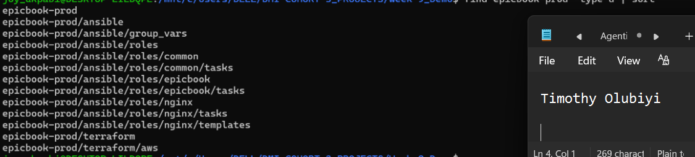

---

### Notes

Answer the following in your own words:

**1. Which cloud provider did you choose for this assignment?**

Azure

---

**2. Why is it useful to keep Terraform files and Ansible files in separate folders?**

Separate folders keep each tool's job, files, and generated data apart, which makes the project easier to run, secure, and maintain.

Clear separation of responsibilities. terraform/ holds infrastructure code (what exists in Azure), and ansible/ holds configuration code (what runs on the server). Anyone opening the project can tell at once which tool does what.
Each tool runs from its own directory. terraform init, plan, and apply read every .tf file in the current folder, and Ansible reads its own inventory.ini, site.yml, and any ansible.cfg from its folder. Mixing them would clutter both and risk one tool picking up the other's files.
Separate generated files. Terraform creates .terraform/, state files, and a lock file. Ansible creates things like retry files and cached facts. Separate folders keep that output from tangling together, and .gitignore rules stay simple.
Better security. Terraform state and terraform.tfvars can contain sensitive values such as your subscription ID. Keeping them in terraform/ makes it easy to protect and exclude them without touching the Ansible files.

---

**3. What is the purpose of the `roles` directory in Ansible?**

The roles directory holds reusable, self-contained units of Ansible automation. A role bundles the tasks, handlers, templates, files, and variables for one job (for example, "install and configure Nginx") into a standard folder layout, so playbooks can call it by name instead of repeating the code.

---

# Task 2 — Provision the Infrastructure with Terraform

## Goal

Run Terraform to provision the cloud infrastructure for the EpicBook deployment.

Terraform will create the VM, managed MySQL database, networking, security rules, and required outputs.

### Evidence

#### Screenshot 2 — `terraform apply` completed successfully

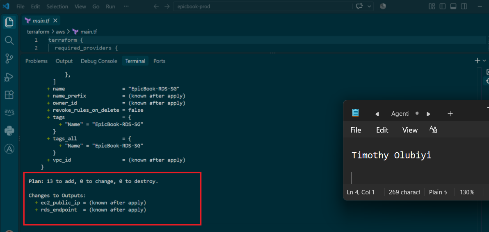

---

#### Screenshot 3 — Output of `terraform output`

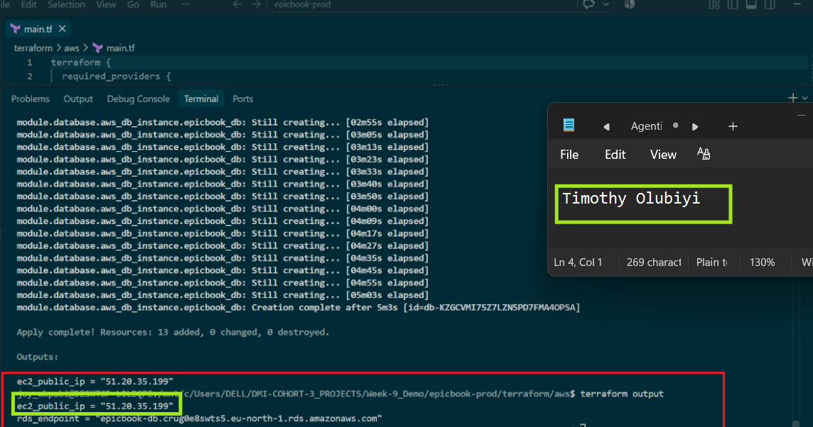

---

#### Screenshot 4 — Azure Portal or AWS Console showing the VM running

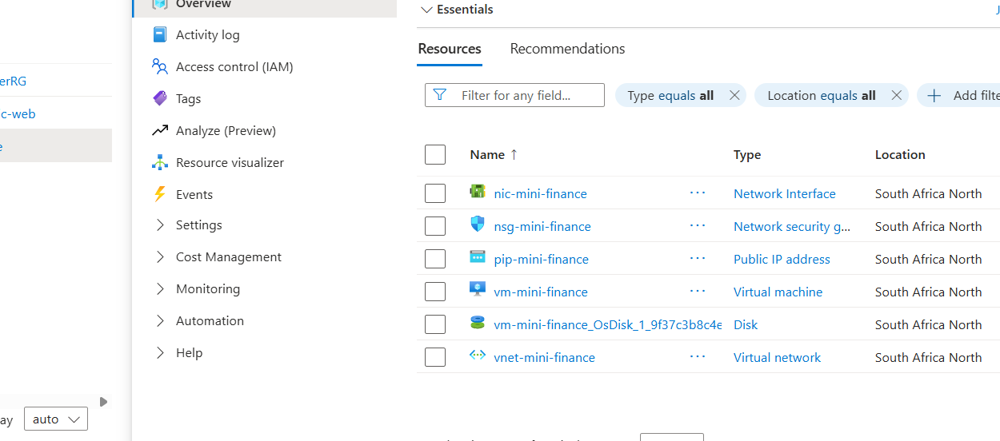

---

#### Screenshot 5 — Azure Portal or AWS Console showing the managed MySQL database created

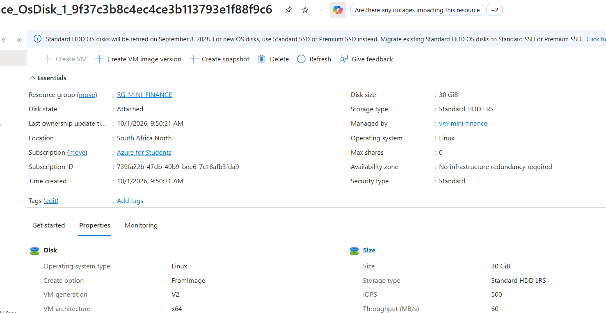

---

### Notes

Answer the following in your own words:

**1. What resources did Terraform create for this assignment?**

Terraform init prepares a folder to be used with Terraform. It reads the provider block in your code (in this case, the AWS provider) and downloads the matching plugin — the piece of software Terraform actually uses to talk to AWS's API. This has to be run once per project folder, which is why it's needed again here even though the code itself was already tested elsewhere: a fresh folder has no providers downloaded yet.
terraform plan is a dry run. It compares what your code says should exist against what Terraform currently knows about (from its state file, which in this case is empty since this is a new project) and prints out exactly what it intends to create, change, or destroy — without actually doing any of it. Reading the plan before applying is a core Terraform habit: it's your last chance to catch a mistake, like a wrong region or an unexpectedly large resource, before it becomes a real, billable cloud resource.

---

**2. Why should you review `terraform plan` before running `terraform apply`?**

1. It shows exactly what will change.
The plan lists every resource that will be created (+), modified (~), destroyed (-), or replaced (-/+). Nothing happens to real infrastructure until you approve it.

2. It catches destructive changes.
Some edits force a resource to be destroyed and recreated, such as changing a database's name, an instance's AMI, or a subnet's CIDR block. Without reviewing the plan, you might accidentally delete a production database or cause downtime.

3. It reveals drift and surprises.
If someone changed a resource manually in the console, or the state file is out of sync, the plan exposes the difference between what Terraform thinks exists and what actually does. It can also show changes you didn't expect from a provider upgrade or a module update.

4. It validates your intent.
A small code change can have a large blast radius. Reading the plan confirms that the diff matches what you meant to do, and that variable values, workspaces, and target environments are correct (for example, that you're not about to apply dev changes to prod).

5. It helps control cost and security.
You can spot expensive resources being added, or security-sensitive changes like opened security group rules, public buckets, or altered IAM policies, before they go live.

6. It supports team review and CI/CD workflows.
Plans can be saved (terraform plan -out=tfplan), posted to pull requests, and reviewed by teammates. Applying that exact saved plan (terraform apply tfplan) guarantees that what was reviewed is what gets executed, with no changes sneaking in between.

---

**3. Why should database passwords not be shown in Terraform output?**

Terraform outputs are easy to leak, and a database password is exactly the kind of value you don't want exposed. Here's why:

1. Outputs are printed in plain text.
Unless an output is marked sensitive = true, its value appears in the terminal after terraform apply and in terraform output. Anyone watching your screen, scrolling back through a shared terminal, or reading your session logs can see it.

2. CI/CD logs persist and are widely readable.
Apply output usually lands in GitHub Actions, GitLab CI, Jenkins, or Terraform Cloud logs. Those logs are often retained for months and visible to many people who should never have database credentials.

3. Outputs are stored in the state file.
Even with sensitive = true, the value is saved in plain text in terraform.tfstate. Marking an output sensitive only hides it from CLI display; it does not encrypt it. So the state file itself must be protected (encrypted remote backend, tight access controls), and you should avoid creating extra copies of the secret in outputs.

4. Outputs spread to other places.
Root module outputs can be read by other configurations via terraform_remote_state, consumed by scripts, or piped into other tools. Each consumer widens the circle of who or what can see the password.

5. It violates least privilege.
People who run plans or read outputs often don't need database access. Exposing the password gives them access they were never meant to have.

6. Leaked credentials are costly.
A password in a log or screenshot must be treated as compromised, which means rotating it, auditing for misuse, and possibly notifying stakeholders.

What to do instead:

Don't output it at all unless something truly needs it.
Mark it sensitive if you must output it: sensitive = true. Treat this as a minimum, not a fix.
Generate and store secrets in a secrets manager such as AWS Secrets Manager, HashiCorp Vault, or Azure Key Vault, and have applications fetch them at runtime. Output only the secret's ARN or name.
Use managed passwords or IAM authentication where supported (for example, RDS manage_master_user_password or IAM database auth), so Terraform never handles the password.

---

# Task 3 — Verify SSH Key-Based Access

## Goal

Verify that the cloud VM can be accessed from the Ansible controller using SSH key-based authentication.

### Evidence

#### Screenshot 6 — Successful SSH hostname check from the Ansible controller

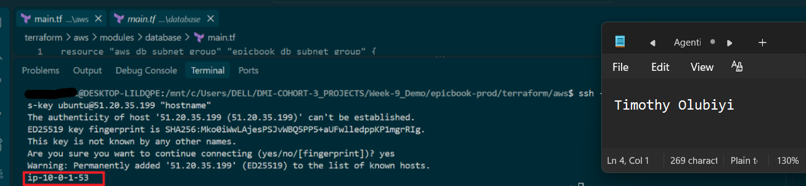

---

### Notes

Answer the following in your own words:

**1. What command did you use to verify SSH access?**

few common approaches are:

ssh -T user@host to test a connection without opening a shell (for GitHub, use ssh -T git@github.com)
ssh -v user@host for verbose output that shows which keys are tried and where authentication fails

---

**2. What proves that SSH key-based access worked successfully?**

1. Verbose output names the method.
Running ssh -v user@host shows lines like:

Offering public key: /home/you/.ssh/id_ed25519
Server accepts key: ...
Authentication succeeded (publickey).

That last line is the clearest proof. If you see Authentication succeeded (password) or keyboard-interactive, the key was not what got you in.

2. No password prompt appears.
If you get a shell without being asked for the account password, a key (or agent) was used. One caveat: if the key has a passphrase, you'll be asked for that, which is different from the account password.

3. Password authentication fails on purpose.
To rule out a silent fallback, force key-only auth:

ssh -o PasswordAuthentication=no -o PubkeyAuthentication=yes user@host

If this logs you in, the key works. If it returns Permission denied (publickey), it doesn't.

4. The server logs confirm it.
On the server, /var/log/auth.log (Debian/Ubuntu) or /var/log/secure (RHEL/CentOS), or journalctl -u ssh, will show an entry like:
Accepted publickey for user from 203.0.113.5 port 52814 ssh2: ED25519 SHA256:...
The fingerprint should match your key, which you can check with ssh-keygen -lf ~/.ssh/id_ed25519.pub.

5. The remote session shows your identity.
Running whoami and echo $SSH_CONNECTION on the remote side confirms you landed in the intended account from the expected client. Also, ssh-add -l locally shows which keys your agent is offering.

---

**3. What would you check if SSH returned `Permission denied (publickey)`?**

1. Run verbose mode first.

ssh -vvv user@host

Look for these lines:

Offering public key: ... shows which keys were tried. If none appear, the client isn't finding a key.
Server accepts key means the key is fine and the problem is later (rare).
No more authentication methods to try means everything was rejected.

2. Check that you're using the right key and username.

Specify the key explicitly: ssh -i ~/.ssh/id_ed25519 user@host
Confirm the username. Cloud images often use ubuntu, ec2-user, admin, or azureuser, not root.
Run ssh-add -l to see what your agent offers. Too many agent keys can exhaust the server's MaxAuthTries before the right one is tried; use -o IdentitiesOnly=yes -i <key> to avoid that.
Check ~/.ssh/config for a Host block overriding IdentityFile or User.

3. Check the key is in authorized_keys on the server.
The public key must be a line in ~/.ssh/authorized_keys of the target user. Compare fingerprints:

ssh-keygen -lf ~/.ssh/id_ed25519.pub
ssh-keygen -lf ~/.ssh/authorized_keys

Also look for stray line breaks or truncation from copy/paste, which break the key.

4. Check permissions and ownership (a very common cause).
sshd refuses keys if the files are too open. On the server:

chmod 700 ~/.ssh
chmod 600 ~/.ssh/authorized_keys
chmod go-w ~
chown -R user:user ~/.ssh

On the client, your private key should be chmod 600, or the client will ignore it.

5. Check the server's sshd configuration.
In /etc/ssh/sshd_config, confirm:

PubkeyAuthentication yes
AuthorizedKeysFile points where you expect
AllowUsers / AllowGroups / DenyUsers aren't excluding your account
PermitRootLogin isn't blocking root
Validate with sudo sshd -t, then reload with sudo systemctl reload sshd.

---

# Task 4 — Create the Ansible Inventory and Configuration

## Goal

Create the Ansible inventory file and local Ansible configuration for the EpicBook VM.

The inventory tells Ansible which VM to manage and which SSH user to use.

### Evidence

#### Screenshot 7 — `inventory.ini` showing the VM under the `web` group

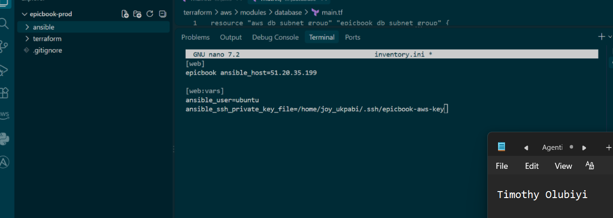

---

#### Screenshot 8 — Output of `ansible-inventory -i inventory.ini --graph`

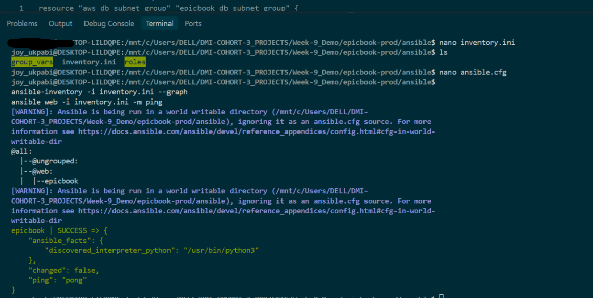

---

#### Screenshot 9 — Output of `ansible web -i inventory.ini -m ping`

---

### Notes

Answer the following in your own words:

**1. What is the purpose of `inventory.ini`?**

inventory.ini is an Ansible inventory file. It tells Ansible which machines to manage and how to reach them.

What it contains:

Hosts: the servers (by hostname or IP) that Ansible will connect to.
Groups: named collections of hosts (e.g. [webservers], [dbservers]) so you can target a playbook at a whole group.
Variables: per-host or per-group settings such as ansible_user, ansible_port, or ansible_ssh_private_key_file.

---

**2. What does `ansible_host` store?**

ansible_host stores the actual address Ansible should connect to for a host: an IP address or DNS name. It lets you use a short, friendly name in the inventory while pointing to the real target.

---

**3. What does `ansible_ssh_private_key_file` tell Ansible?**

ansible_ssh_private_key_file tells Ansible which SSH private key to use when authenticating to a host. It's the Ansible equivalent of ssh -i <key>.

---

**4. Why is `host_key_checking = False` used only for this temporary lab?**

Because disabling host key checking removes SSH's protection against man-in-the-middle attacks, which is an acceptable trade-off only in a throwaway environment.

What host key checking does:
The first time you connect, SSH records the server's host key in ~/.ssh/known_hosts. On later connections it verifies the key matches. If it changes, SSH warns you, because it could mean someone is impersonating the server.
---

# Task 5 — Create the Main Ansible Playbook

## Goal

Create the main Ansible playbook that runs the required roles in the correct order.

The `site.yml` file will call the `common`, `nginx`, and `epicbook` roles.

### Evidence

#### Screenshot 10 — `site.yml` showing the roles in the correct order

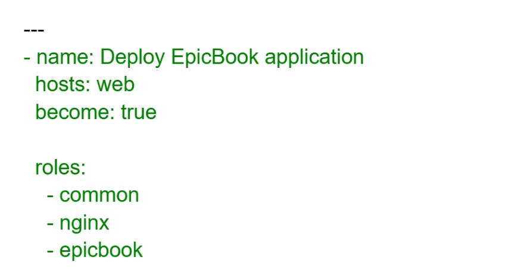

---

#### Screenshot 11 — Output of `ansible-playbook -i inventory.ini site.yml --syntax-check`

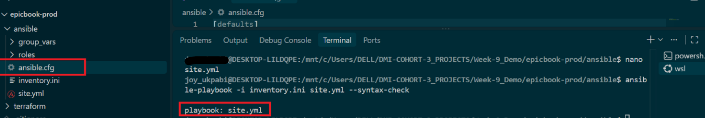

---

### Notes

Answer the following in your own words:

**1. What is the purpose of `site.yml`?**

site.yml is a conventional name for the main Ansible playbook, the top-level entry point that defines what gets configured on which hosts. Ansible doesn't require the name, but it's a widely followed convention.

---

**2. Why should the roles run in the order `common`, `nginx`, and `epicbook`?**

1. common first (the baseline).
It handles things every server needs before anything else: updating the package cache, installing base packages (curl, git, unzip), creating users, setting timezone, and basic security settings. Later roles assume these are in place. If nginx ran first, a stale package cache or missing dependency could make its install fail.

2. nginx second (the platform).
It installs and starts the web server, and sets up its base configuration, directories, and firewall rules. The application needs this layer to exist before it can be served or proxied.

3. epicbook last (the application).
It deploys the actual app: code, its configuration, and the nginx site/virtual host that points to it. That step needs nginx already installed (so the config directories exist and the service can be reloaded) and the common packages available (such as git to fetch the code).

The general principle: run roles from most general and foundational to most specific. Infrastructure and shared dependencies come first, and the application layer comes last.
---

**3. What does `become: true` allow Ansible to do?**

become: true lets Ansible escalate privileges on the remote host, by default running tasks as root via sudo. Without it, tasks run as the SSH login user (e.g. ubuntu), which can't install packages, edit files in /etc, or manage services.

---

# Task 6 — Create the `common` Role

## Goal

Create the `common` role to prepare the Ubuntu VM with the basic packages required for the EpicBook deployment.

This role handles the common server setup before Nginx and the application are configured.

### Evidence

#### Screenshot 12 — `roles/common/tasks/main.yml` showing the common setup tasks

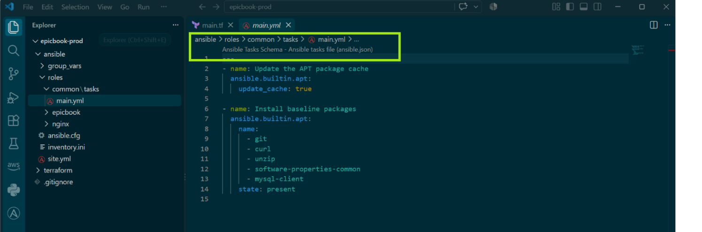

---

### Notes

Answer the following in your own words:

**1. What is the responsibility of the `common` role?**

The common role is the baseline setup that every server in your environment needs, regardless of what it will eventually run. It prepares the machine so later roles (nginx, epicbook) can work reliably.
---

**2. Why should Nginx installation not be placed inside the `common` role?**

Because common should only hold what every server needs, and nginx is specific to web servers.

1. Separation of concerns.
Each role should do one job. Mixing nginx into common turns it into a grab-bag that's hard to read, test, and maintain.

2. Not every host needs it.
common runs on all machines, including database servers. Installing nginx there wastes resources, opens an unnecessary port, and enlarges the attack surface.

3. Reusability.
A standalone nginx role can be applied to any host group, reused in other projects, or shared, without dragging along unrelated baseline tasks.

4. Independent configuration.
Nginx has its own variables, templates, handlers (reload/restart), and files. Keeping these in one role means common doesn't need to know about nginx handlers or config paths.
---

**3. Why is `mysql-client` useful in this deployment?**

mysql-client provides the mysql command-line tool (plus related utilities like mysqldump), letting a server connect to a MySQL database without running a MySQL server itself.

---

# Task 7 — Create the `nginx` Role

## Goal

Create the `nginx` role to install Nginx and configure it as a reverse proxy for the EpicBook application.

Nginx will receive browser traffic on port `80` and forward it to the EpicBook Node.js application running on the VM.

### Evidence

#### Screenshot 13 — `roles/nginx/tasks/main.yml` showing Nginx installation and site configuration tasks

---

#### Screenshot 14 — `roles/nginx/templates/epicbook.conf.j2` showing the reverse proxy configuration

---

### Notes

Answer the following in your own words:

**1. What is the responsibility of the `nginx` role?**

Responsibility of the nginx role: install, configure, and run nginx as the web server layer, so the application can be served through it.

---

**2. Why is Nginx configured as a reverse proxy in this deployment?**

Short answer: because the application server (e.g., Node/Express, Gunicorn, PHP-FPM) isn't built to face the internet directly, and nginx handles that front-line work better.

---

**3. Why should the application port come from `group_vars/web.yml` instead of being hard-coded?**

Short answer: so the port is defined once, in one place, and every file that needs it reads the same value.

---

# Task 8 — Create the `epicbook` Role

## Goal

Create the `epicbook` role to deploy the EpicBook application, connect it to the managed MySQL database, and run the application on port `8080` using PM2.

### Evidence

#### Screenshot 15 — `roles/epicbook/tasks/main.yml` showing application deployment tasks

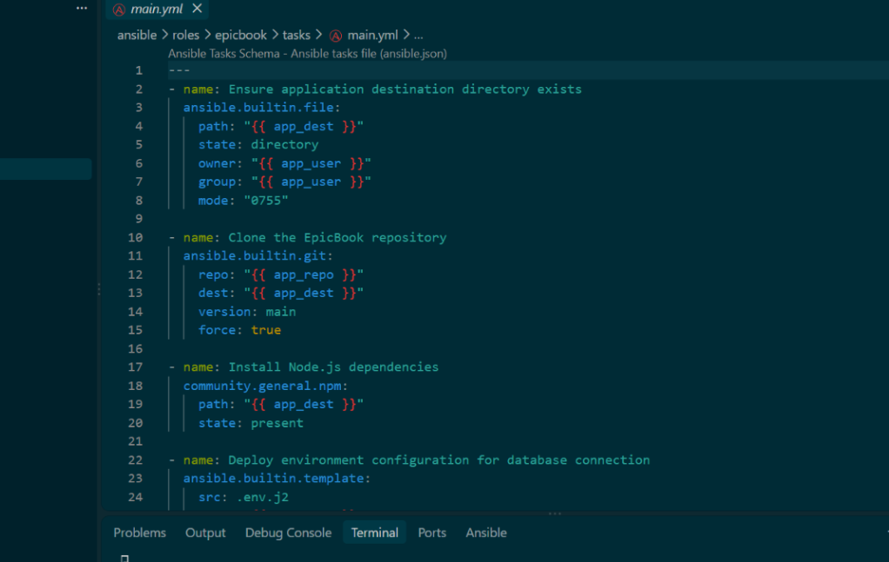

---

#### Screenshot 16 — Task or file showing how the database connection is configured, with secrets hidden

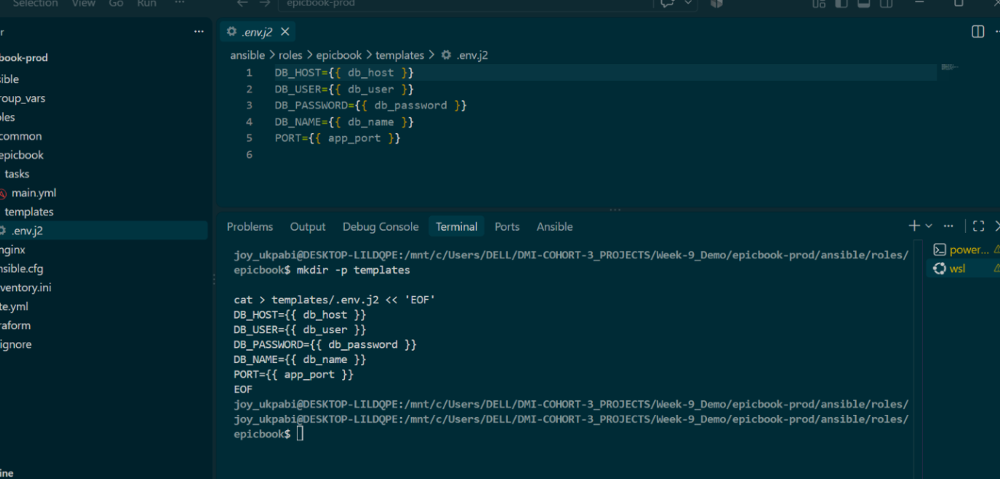

---

#### Screenshot 17 — Task or output showing the EpicBook application managed by PM2

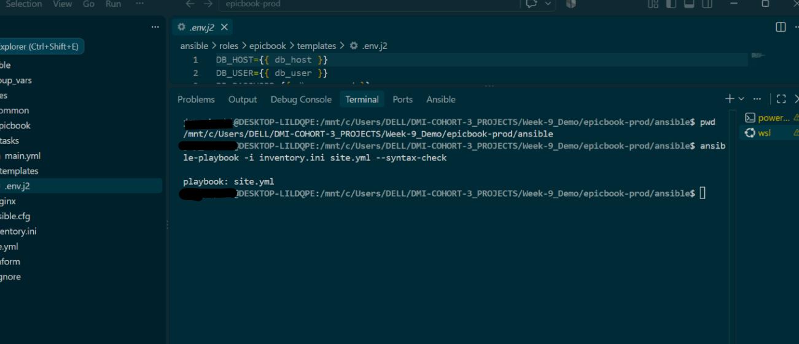
---

### Notes

Answer the following in your own words:

**1. What is the responsibility of the `epicbook` role?**

Responsibility of the epicbook role: deploy and run the actual application on top of the platform that common and nginx prepared.

---

**2. Why is PM2 used for the EpicBook Node.js application?**

Short answer: because running node app.js directly ties the app to your terminal session and gives no recovery if it crashes. PM2 is a process manager that keeps a Node.js app running reliably in production.

---

**3. Why should database passwords not be hard-coded in public files?**

Short answer: because anyone who can read the file can read the password, and public files are readable by everyone.
---

**4. What does it mean for the application to run on port `8080` while Nginx listens on port `80`?**

Short answer: two separate processes are listening on two different ports. Nginx faces the public on port 80, and the application listens on 8080 behind it. Nginx forwards each request from the first to the second.

---

# Task 9 — Create Group Variables

## Goal

Create reusable variables for the EpicBook deployment.

The `group_vars/web.yml` file stores values that can be reused across the Ansible roles.

### Evidence

#### Screenshot 18 — `group_vars/web.yml` showing the application, PM2, and database variables, with passwords hidden or masked

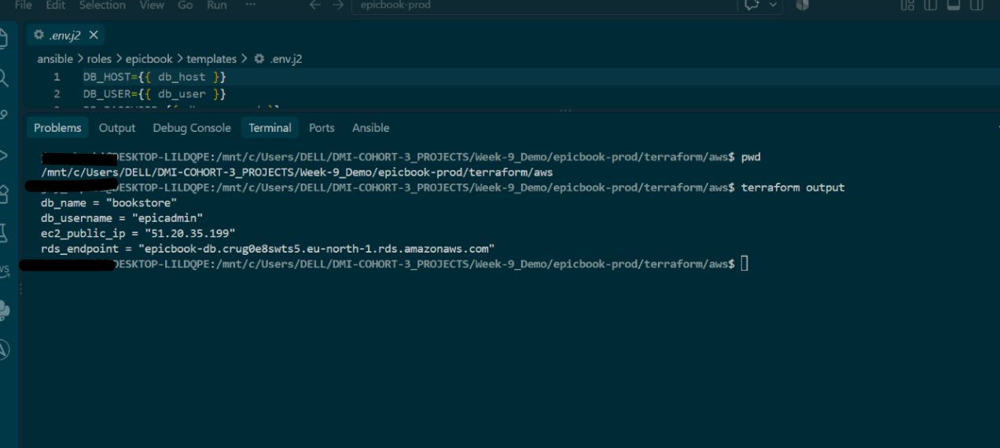

---

### Notes

Answer the following in your own words:

**1. What is the purpose of `group_vars/web.yml`?**

Purpose: group_vars/web.yml holds the variables that apply to every host in the inventory group named web. Ansible loads it automatically, with no vars_files or include_vars needed.

---

**2. Which values did you store in `group_vars/web.yml`?**

---

**3. How did you handle the database password securely?**

Ansible Vault: keep the real password in an encrypted file (ansible-vault encrypt group_vars/web/vault.yml) and reference it from group_vars/web.yml as db_password: "{{ vault_db_password }}".
Vault password stays out of the repo: use --ask-vault-pass, or a password file listed in .gitignore, or a CI secret.
Render into a protected file: template the password into the app's .env with mode: "0600", owned by the app user.

---

# Task 10 — Run the Ansible Playbook

## Goal

Run the Ansible playbook to configure the VM and deploy the EpicBook application.

The playbook should run the roles in this order:

1. `common`
2. `nginx`
3. `epicbook`

### Evidence

#### Screenshot 19 — Ansible playbook output showing the roles running

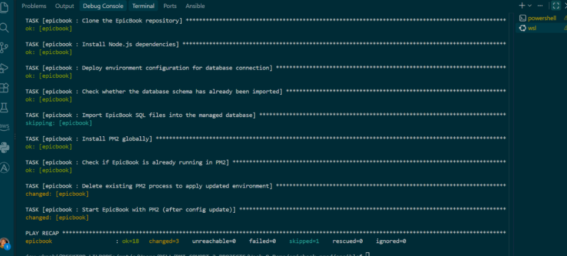

---

#### Screenshot 20 — Final Ansible recap showing `failed=0`

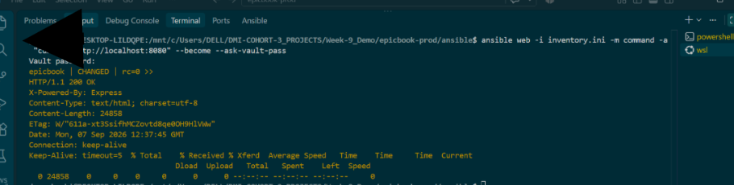

---

#### Screenshot 21 — Output of `ansible web -i inventory.ini -m command -a "systemctl is-active nginx" --become`

---

#### Screenshot 22 — Output of `ansible web -i inventory.ini -m command -a "pm2 status"`

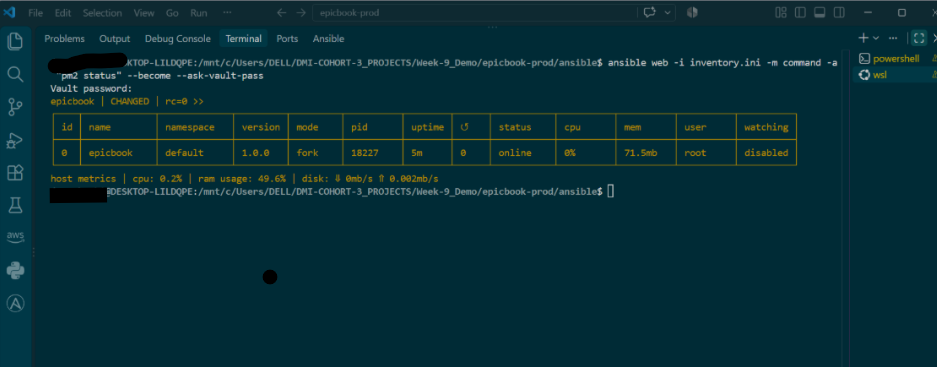

---

#### Screenshot 23 — Output of `ansible web -i inventory.ini -m command -a "curl -I http://localhost:8080"`

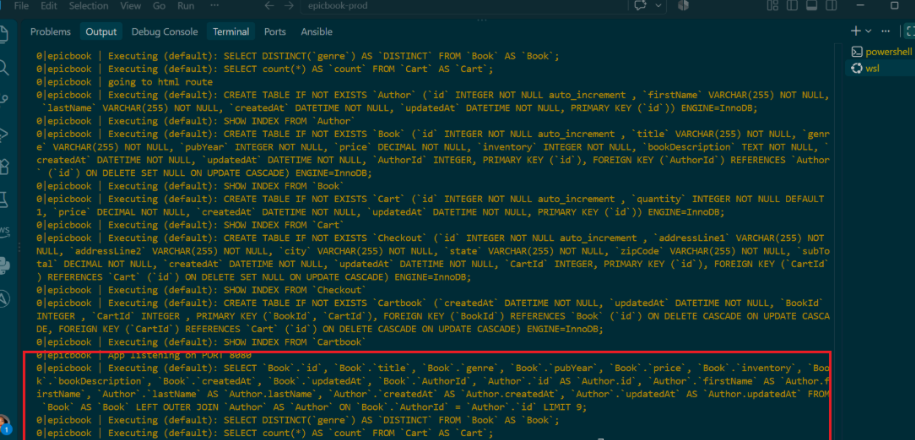

---

### Notes

Answer the following in your own words:

**1. What command did you run to execute the Ansible playbook?**

---

**2. How do you know all roles completed successfully?**

---

**3. What proves that Nginx is active?**

---

**4. What proves that PM2 is managing the EpicBook application?**

---

**5. What proves that the EpicBook application responds on port `8080`?**

---

# Task 11 — Verify the EpicBook Deployment

## Goal

Verify that the EpicBook application is running, accessible in the browser, and connected to the managed MySQL database.

### Evidence

#### Screenshot 24 — Output of `curl -I http://<public_ip>`

---

#### Screenshot 25 — Output of the cart API test command

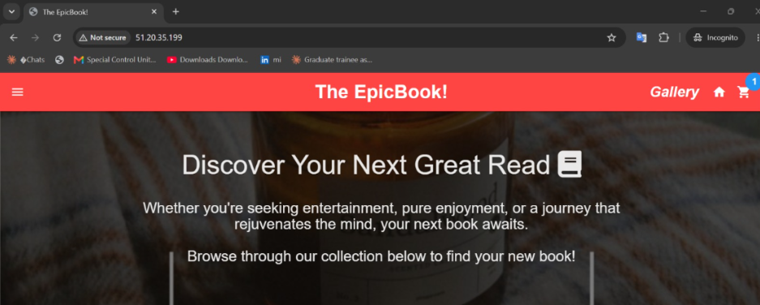

---

#### Screenshot 26 — Output of the `/cart` HTTP status check

---

#### Screenshot 27 — Browser showing the EpicBook application loaded from `http://<public_ip>`

---

### Notes

Answer the following in your own words:

**1. What HTTP response did you receive from the public application URL?**

---

**2. What did the cart API test prove?**

---

**3. What did the `/cart` status check return?**

---

**4. What issue did you face during verification, and how did you fix it?**

---

# LinkedIn Post Required

## Evidence

#### LinkedIn Post URL

Paste your LinkedIn post URL here:

---

#### Screenshot — Published LinkedIn post

---

# Assignment Questions

Answer the following in your own words:

**1. Why is Terraform used for infrastructure provisioning?**

---

**2. Why are Ansible roles useful for production-style deployments?**

---

**3. What is the purpose of `group_vars/web.yml`?**

---

**4. Why should database passwords not be committed to GitHub?**

---

**5. What is the purpose of Nginx in this deployment?**

---

**6. Why should the managed MySQL database not be publicly accessible?**

---

**7. Why is PM2 used for the EpicBook Node.js application?**

---

**8. What does idempotency mean in Ansible?**

---

**9. What issue did you face during the deployment, and how did you fix it?**

---

**10. What security improvement would you make before using this setup in production?**

---

# Required Files

Confirm that the following files are included in your GitHub repository or assignment folder:

- [✅] `README.md`
- [✅] Terraform files under either `terraform/azure/` or `terraform/aws/`
- [✅] `ansible/ansible.cfg`
- [✅] `ansible/inventory.ini`
- [✅] `ansible/site.yml`
- [✅] `ansible/group_vars/web.yml`
- [✅] `ansible/roles/common/tasks/main.yml`
- [✅] `ansible/roles/nginx/tasks/main.yml`
- [✅] `ansible/roles/nginx/templates/epicbook.conf.j2`
- [✅] `ansible/roles/epicbook/tasks/main.yml`

---

# Submission Instructions

- Add all required screenshots in your submission.
- Full Name must be visible in required screenshots.
- Mention the cloud provider used: Azure or AWS.
- Add the VM public IP address.
- Add the final application URL.
- Add Terraform output proof.
- Add Ansible role tree proof.
- Add all required notes and assignment question answers.
- Add your LinkedIn post URL.
- Do not expose SSH private keys, passwords, cloud credentials, database credentials, Terraform state files, subscription IDs, or account IDs.

---

# Completion Checklist

- [✅] Task 1: Project folder layout created
- [✅] Task 2: Terraform infrastructure provisioned
- [✅] Task 3: SSH key-based access verified
- [✅] Task 4: Ansible inventory and configuration created
- [✅] Task 5: Main Ansible playbook created
- [✅] Task 6: `common` role created
- [✅] Task 7: `nginx` role created
- [✅] Task 8: `epicbook` role created
- [✅] Task 9: Group variables created
- [✅] Task 10: Ansible playbook run completed
- [✅] Task 11: EpicBook deployment verified
- [✅] Terraform files created under only one cloud provider folder
- [✅] One Ubuntu VM was created
- [✅] One managed MySQL database was created
- [✅] SSH port `22` is restricted to the controller public IP
- [✅] HTTP port `80` is accessible
- [✅] MySQL port `3306` is not publicly open
- [✅] `ansible web -i inventory.ini -m ping` returns `SUCCESS`
- [✅] `site.yml` calls the roles in the correct order
- [✅] Database secrets are hidden or handled securely
- [✅] Nginx is active
- [✅] PM2 shows the EpicBook application running
- [✅] EpicBook responds on port `8080`
- [✅] Public URL loads in the browser
- [✅] Cart API verification works
- [✅] Playbook completes with `failed=0`
- [✅] Screenshots 1–27 are included
- [✅] Assignment questions are answered
- [✅] LinkedIn post published
- [✅] LinkedIn post URL added
- [✅] No sensitive information is exposed

---

## About DMI & CloudAdvisory

DevOps Micro Internship (DMI) is a project-based DevOps program run by Pravin Mishra and The CloudAdvisory, focused on real-world execution, systems thinking, and career readiness.

It helps learners build strong DevOps foundations with hands-on experience.

---

## Resources

- DMI Official Website: [https://dmi.pravinmishra.com?utm_source=github&utm_medium=readme](https://dmi.pravinmishra.com?utm_source=github&utm_medium=readme)
- University: [https://university.pravinmishra.com?utm_source=github&utm_medium=readme](https://university.pravinmishra.com?utm_source=github&utm_medium=readme)
- Discord Community: [https://discord.pravinmishra.com?utm_source=github&utm_medium=readme](https://discord.pravinmishra.com?utm_source=github&utm_medium=readme)
- Blog: [https://dmi.pravinmishra.com/blog?utm_source=github&utm_medium=readme](https://dmi.pravinmishra.com/blog?utm_source=github&utm_medium=readme)
- YouTube Playlist: [https://www.youtube.com/playlist?list=PLFeSNDtI4Cho](https://www.youtube.com/playlist?list=PLFeSNDtI4Cho)
- Pravin Mishra LinkedIn: [https://www.linkedin.com/in/pravin-mishra-aws-trainer/](https://www.linkedin.com/in/pravin-mishra-aws-trainer/)
- CloudAdvisory LinkedIn: [https://www.linkedin.com/company/thecloudadvisory/](https://www.linkedin.com/company/thecloudadvisory/)

---

*This submission is part of DevOps Micro Internship (DMI) — Agentic AI Track.*