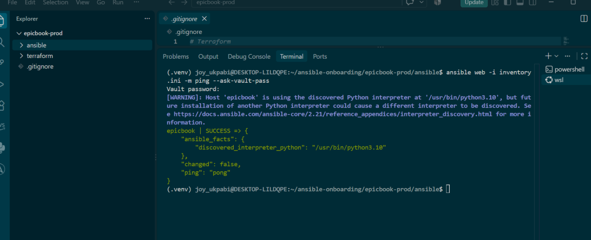
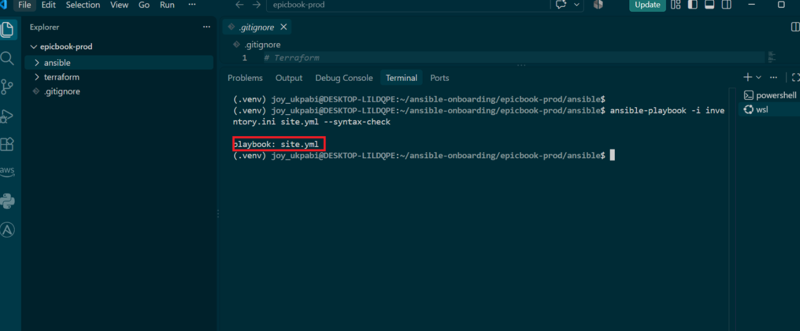
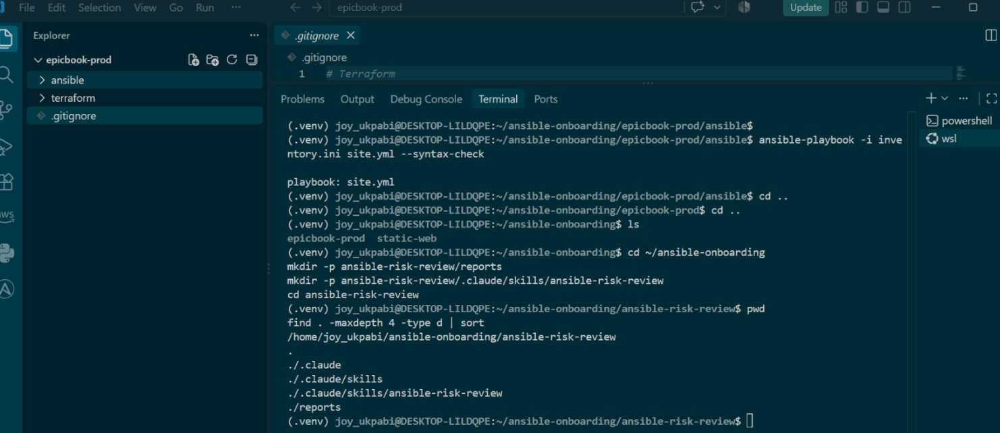
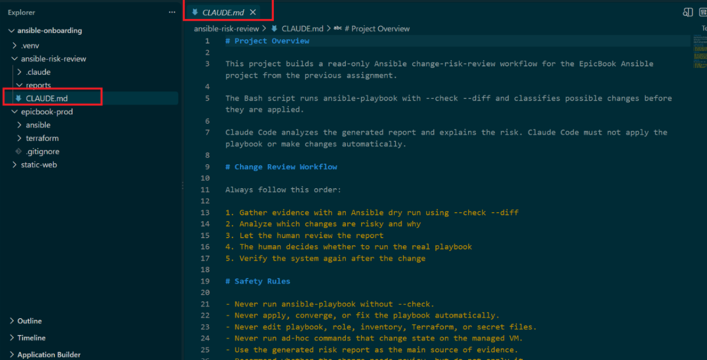
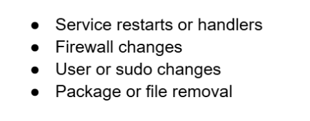
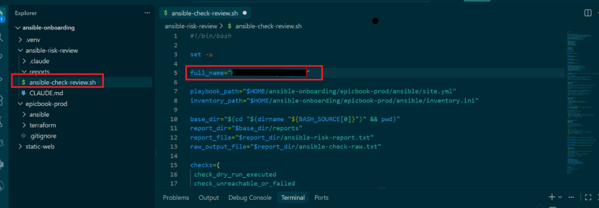
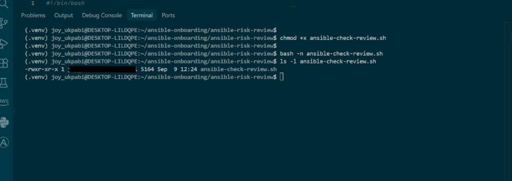
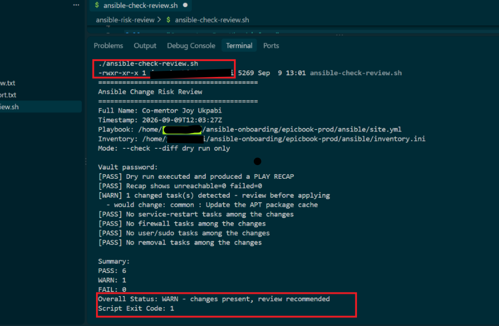
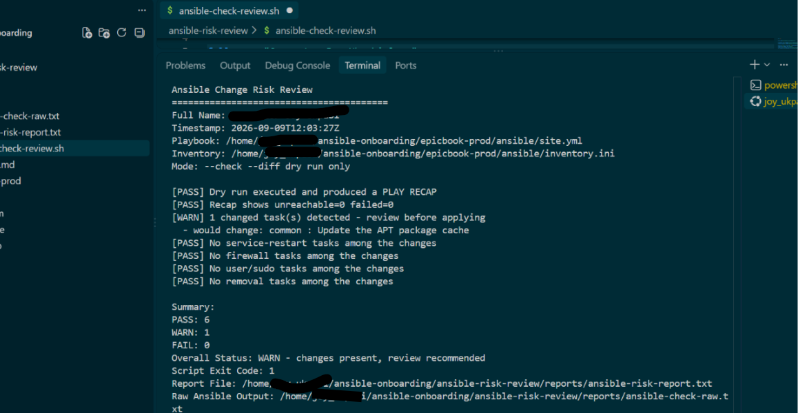
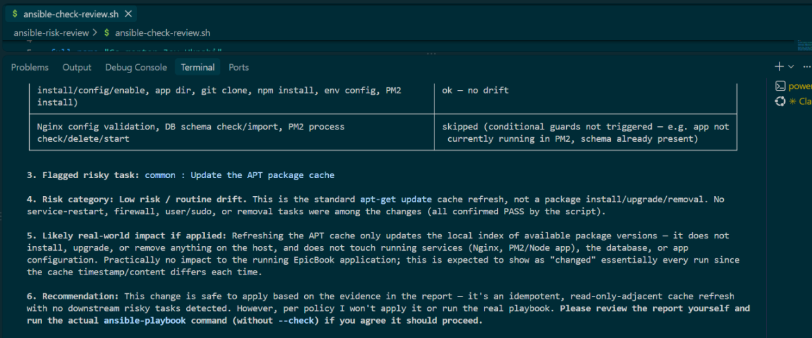

# Assignment 6 — AI-Assisted Ansible Change Risk Review

Part of the DevOps Micro Internship (DMI) with Agentic AI

---

## Purpose

In this assignment, you will build an AI-assisted Ansible risk-review workflow using `ansible-playbook --check --diff`, Bash scripting, and Claude Code.

You will review possible server changes before applying them, classify risky tasks, and keep the final apply decision under human control.

---

# Task 1 — Confirm EpicBook Connectivity and Create the Workspace

## Goal

Confirm that your previous EpicBook Ansible project is working before creating the risk-review automation.

### Evidence

#### Screenshot 1 — Output of `ansible web -i inventory.ini -m ping`

---

#### Screenshot 2 — Output of `ansible-playbook -i inventory.ini site.yml --syntax-check`

---

#### Screenshot 3 — Output of `pwd` and `find . -maxdepth 4 -type d | sort`

---

### Notes

Answer the following in your own words:

**1. What proves that Ansible can reach your EpicBook VM?**

What proves that Ansible can reach the EpicBook VM is a successful Ansible ping test. When I run ansible epicbook -i inventory.ini -m ping and receive a response showing SUCCESS with "ping": "pong", it confirms that Ansible can connect to the VM through SSH and successfully execute an Ansible module on the remote server. This demonstrates that the inventory configuration, IP address, SSH credentials, and remote access are all working correctly.

---

**2. Why should you confirm playbook syntax before building a risk-review script?**

You should confirm the playbook syntax before building a risk-review script because the risk-review script depends on the playbook being valid and correctly structured. Running a syntax check first helps identify YAML formatting errors, incorrect indentation, invalid Ansible modules, or configuration mistakes early. This prevents the risk-review script from analyzing a broken playbook and producing misleading results, saving time and making the automation more reliable.

---

# Task 2 — Create Project Context and Safety Rules in CLAUDE.md

## Goal

Create a `CLAUDE.md` file that tells Claude Code how this project must behave.

### Evidence

#### Screenshot 4 — `CLAUDE.md` open in VS Code or terminal showing the safety rules

---

### Notes

Answer the following in your own words:

**1. Why should Claude Code have project-specific safety rules?**

Claude Code should have project-specific safety rules because every project has different requirements, risks, infrastructure, and access levels. These rules help control what actions the AI can perform, such as preventing unauthorized changes to production systems, protecting credentials and sensitive files, and requiring confirmation before running potentially destructive commands. This makes the AI-assisted development process safer, more predictable, and aligned with the project's specific needs.

---

**2. Why should the human run the real Ansible playbook manually?**

The human should run the real Ansible playbook manually because the playbook may make actual changes to servers, applications, configurations, or data. Manual execution keeps the human in control, allowing them to review the playbook, confirm the target hosts and variables, and monitor the changes as they happen. This reduces the risk of unintended or destructive changes and provides a clear point of human approval before applying automation to a real environment.

---

**3. Which rule prevents Claude Code from applying changes automatically?**

The human-approval rule prevents Claude Code from applying changes automatically. It requires Claude Code to review, explain, and prepare the changes, while the human must manually approve and execute the actual Ansible playbook. This ensures that potentially impactful changes are not applied without human oversight.

---

# Task 3 — Ask Claude Code to Plan the Risk Review

## Goal

Use Claude Code to produce a read-only plan before writing the Bash script.

### Evidence

#### Screenshot 5 — Claude Code showing the four-category risk-classification plan

---

### Notes

Answer the following in your own words:

**1. Which part of this task represents the Gather phase?**

The Gather phase is the part where Claude collects information about the environment before making any changes. For example, it can inspect the Ansible inventory, playbook, VM details, connectivity, configuration files, and existing system state. The purpose is to understand what is currently in place and identify relevant risks before moving to the review or implementation phase.

---

**2. Which part represents the Analyze phase?**

The Analyze phase is where Claude reviews the information gathered and identifies potential risks, errors, security issues, and possible impacts. For example, Claude can analyze the Ansible playbook for risky commands, incorrect configurations, privilege escalation, or changes that could affect the EpicBook VM before any changes are applied.

---

**3. How did you verify Claude Code did not create or edit files?**

I verified that Claude Code did not create or edit files by checking the project directory before and after the task and confirming that there were no new or modified files. I also reviewed the Git status to ensure there were no uncommitted changes. This confirmed that Claude Code only analyzed the project and did not make any file modifications.

---

# Task 4 — Build the Ansible Risk Review Script

## Goal

Create a Bash script that runs an Ansible dry run and classifies risky changes.

### Evidence

#### Screenshot 6 — Top section of `ansible-check-review.sh` showing `full_name`, `playbook_path`, `inventory_path`, and the `checks` array

---

#### Screenshot 7 — Middle section showing `extract_changed_tasks` and `check_tasks_matching_pattern`

---

#### Screenshot 8 — Bottom section showing the loop, summary, and exit behavior

---

#### Screenshot 9 — Output of `bash -n ansible-check-review.sh` and `ls -l ansible-check-review.sh`

---

### Notes

Answer the following in your own words:

**1. What is stored in the `changed_tasks` array?**

The changed_tasks array stores the Ansible tasks that are expected to make changes to the target system when the playbook runs. It helps identify potentially impactful tasks, such as installing packages, modifying configuration files, creating users, or starting and stopping services, so they can be reviewed before execution.

---

**2. Which function finds changed tasks from the Ansible output?**

The function that finds changed tasks from the Ansible output is the extract_changed_tasks() function. It processes the Ansible output and identifies tasks where the result indicates changed: true, storing those tasks in the changed_tasks array for further risk analysis.

---

**3. Why does the script use `--check --diff`?**

The script uses --check --diff to safely preview what Ansible would change without actually applying those changes. The --check option runs the playbook in dry-run mode, while --diff shows the specific differences that would be made to files or configurations. This allows the changes to be reviewed and analyzed for risks before the real playbook is executed.

---

**4. Why does the script use different exit codes for healthy, warning, and failed results?**

The script uses different exit codes to clearly communicate the severity of the result to both humans and automation tools. A healthy result can return 0, a warning can return a different non-zero code, and a failed result can return a higher or distinct code. This makes it easier for CI/CD pipelines, monitoring systems, or other scripts to automatically determine whether the risk review passed, needs attention, or failed.

---

# Task 5 — Run the Baseline Dry-Run Review

## Goal

Run the script against your current EpicBook playbook and confirm the baseline risk status.

### Evidence

#### Screenshot 10 — Output of `./ansible-check-review.sh`

---

#### Screenshot 11 — Output of `echo "Captured Exit Code: $script_exit_code"` and `cat reports/ansible-risk-report.txt`

---

### Notes

Answer the following in your own words:

**1. What was the overall status of your baseline run?**

The overall status of the baseline run was healthy. The baseline completed successfully without detecting any critical issues, meaning the environment and Ansible configuration were functioning as expected before proceeding with further changes.

---

**2. Did any tasks report `changed`?**

No. No tasks reported changed during the baseline run. This means Ansible did not detect any changes that needed to be applied to the EpicBook VM.

---

**3. Were any changed tasks flagged as risky?**

No changed tasks were flagged as risky because the baseline run did not report any tasks as changed. Therefore, there were no changes requiring further risk assessment.

---

**4. What does the script exit code mean?**

A warning exit code indicates that attention is needed, while a failure exit code indicates that a serious error or risky condition was detected.

---

# Task 6 — Create and Run the Claude Code Skill

## Goal

Turn the Bash script into a reusable Claude Code skill called `/ansible-risk-review`.

### Evidence

#### Screenshot 12 — `SKILL.md` showing the frontmatter, allowed tools, and safety rules

---

#### Screenshot 13 — Claude Code output after running `/ansible-risk-review`

---

### Notes

Answer the following in your own words:

**1. Why does this skill allow `Bash`, `Read`, and `Grep`?**

The skill allows Bash, Read, and Grep because these tools are needed to safely inspect and analyze the project. Read views files, Grep searches for specific patterns or configurations, and Bash runs commands such as Ansible syntax checks and the --check --diff dry run. Together, they allow Claude to gather and analyze information without automatically modifying the system.

---

**2. Why does this skill not allow file editing?**

This skill does not allow file editing to prevent Claude from making unauthorized or unintended changes to the project or infrastructure. Its purpose is to inspect, analyze, and review the Ansible configuration, while keeping actual modifications under human control. This provides an additional safety layer before any changes are manually applied.

---

**3. What part is handled by Bash?**

The Bash part handles the execution of command-line operations. In this task, it is used to run commands such as Ansible syntax checks, connectivity tests, and the --check --diff dry run. This allows the environment and proposed changes to be tested and reviewed without Claude automatically editing files or applying the real playbook.

---

**4. What part is handled by Claude Code?**

The Claude Code part handles the gathering, analysis, and risk review of the Ansible project. It reads the relevant files, examines the Ansible output, identifies tasks that could make changes, checks for potential risks, and summarizes the findings. It does not automatically apply the real playbook or make file edits, keeping the final execution under human control.

---

**5. Why is this better than asking Claude Code if the playbook is safe without giving it evidence?**

This is better because Claude Code is given actual evidence from the environment, such as the playbook, Ansible output, syntax-check results, and --check --diff results. Instead of simply asking whether the playbook is safe based on assumptions, Claude can analyze what the playbook would actually do and identify potential risks. This makes the review more objective, verifiable, and reliable before the human runs the real playbook.

---

# Task 7 — Introduce a Controlled Risky Change and Let the Skill Catch It

## Goal

Add a small controlled risky change in your lab playbook and confirm the script and Claude Code catch it before applying.

### Evidence

#### Screenshot 14 — The added risky task inside the role file

---

#### Screenshot 15 — Output of `./ansible-check-review.sh`

---

#### Screenshot 16 — Claude Code `/ansible-risk-review` output showing the risky finding

---

#### Screenshot 17 — Output of `cat reports/risky-change-report.txt`

---

### Notes

Answer the following in your own words:

**1. Which risk category did the added task fall into?**

---

**2. What evidence proves the task would change something?**

---

**3. Did Claude Code apply the playbook?**

---

**4. Why is it important that Claude Code only analyzed the risk?**

---

**5. Which phase of the Agentic Loop is represented by the Bash report?**

---

# Task 8 — Apply as the Human, Verify, and Write the Change Summary

## Goal

Review the risky-change report, apply the playbook manually as the human operator, and verify the result.

### Evidence

#### Screenshot 18 — Output of the real playbook run showing the final recap with `failed=0`

---

#### Screenshot 19 — Output of `ansible web -i inventory.ini -m ping`

---

#### Screenshot 20 — Second `/ansible-risk-review` output after applying the change

---

#### Screenshot 21 — Output of `ls -lah reports`

---

#### Screenshot 22 — `change-summary.md` showing all required sections and your Full Name

---

### Notes

Answer the following in your own words:

**1. What command did you run to apply the change for real?**

ansible-playbook -i inventory.ini playbook.yml

---

**2. Who made the final decision to apply the playbook?**

The human operator made the final decision to apply the playbook. Claude Code only gathered the evidence, analyzed the proposed changes, and performed the risk review; the actual execution was manually approved and carried out by the human.

---

**3. What evidence proves the VM is still reachable?**

The evidence that proves the VM is still reachable is a successful Ansible connectivity test after the changes. When the command returns SUCCESS with "ping": "pong", it confirms that Ansible can still connect to the EpicBook VM and execute a module successfully. This verifies that the VM remains accessible after the playbook was applied.

---

**4. Why should the risk review be run again after applying?**
The risk review should be run again after applying the changes to verify the actual result. The second review confirms whether the intended changes were made, identifies any unexpected changes or new risks, and checks that the system remains in a healthy state. This provides a before-and-after comparison and helps confirm that the deployment did not introduce problems.

---

**5. What could go wrong if an AI agent applied Ansible changes automatically?**

If an AI agent applied Ansible changes automatically, it could modify the wrong server, overwrite important configurations, install or remove packages, expose sensitive information, or cause service downtime because of an incorrect assumption or misunderstood instruction. It could also make multiple changes quickly, making the problem harder to detect and reverse. Requiring a human to review and approve the changes provides an important safety check before they are applied to the real environment.

---

# LinkedIn Post Required

## Evidence

#### LinkedIn Post URL

Paste your LinkedIn post URL here:

---

#### Screenshot — Published LinkedIn post

---

# Required Files

Confirm that the following files are included in your GitHub repository or assignment folder:

- [✅] `CLAUDE.md`
- [✅] `ansible-check-review.sh`
- [✅] `.claude/skills/ansible-risk-review/SKILL.md`
- [✅] `reports/risky-change-report.txt`
- [✅] `reports/post-apply-report.txt`
- [✅] `change-summary.md`

---

# Submission Instructions

- Add all required screenshots in your submission.
- Full Name must be visible in required screenshots and reports.
- All required notes must be answered clearly.
- Do not expose SSH private keys, passwords, cloud credentials, database credentials, or secret environment variables.
- Add your GitHub repository or folder URL inside this document.

---

# Completion Checklist

- [✅] Task 1: EpicBook connectivity confirmed and workspace created
- [✅] Task 2: `CLAUDE.md` created with safety rules
- [✅] Task 3: Claude Code produced a read-only risk-review plan
- [✅] Task 4: `ansible-check-review.sh` created and syntax checked
- [✅] Task 5: Baseline dry-run review completed
- [✅] Task 6: Claude Code `/ansible-risk-review` skill created and tested
- [✅] Task 7: Controlled risky change introduced and detected
- [✅] Task 8: Human applied the change and verified the result
- [✅] Risky-change report saved
- [✅] Post-apply report saved
- [✅] Change summary completed
- [✅] All screenshots added
- [✅] All notes answered
- [✅] LinkedIn post published
- [✅] LinkedIn post URL added
- [✅] No sensitive information exposed

---

## About DMI & CloudAdvisory

DevOps Micro Internship (DMI) is a project-based DevOps program run by Pravin Mishra and The CloudAdvisory, focused on real-world execution, systems thinking, and career readiness.

It helps learners build strong DevOps foundations with hands-on experience.

---

## Resources

- DMI Official Website: [https://dmi.pravinmishra.com?utm_source=github&utm_medium=readme](https://dmi.pravinmishra.com?utm_source=github&utm_medium=readme)
- University: [https://university.pravinmishra.com?utm_source=github&utm_medium=readme](https://university.pravinmishra.com?utm_source=github&utm_medium=readme)
- Discord Community: [https://discord.pravinmishra.com?utm_source=github&utm_medium=readme](https://discord.pravinmishra.com?utm_source=github&utm_medium=readme)
- Blog: [https://dmi.pravinmishra.com/blog?utm_source=github&utm_medium=readme](https://dmi.pravinmishra.com/blog?utm_source=github&utm_medium=readme)
- YouTube Playlist: [https://www.youtube.com/playlist?list=PLFeSNDtI4Cho](https://www.youtube.com/playlist?list=PLFeSNDtI4Cho)
- Pravin Mishra LinkedIn: [https://www.linkedin.com/in/pravin-mishra-aws-trainer/](https://www.linkedin.com/in/pravin-mishra-aws-trainer/)
- CloudAdvisory LinkedIn: [https://www.linkedin.com/company/thecloudadvisory/](https://www.linkedin.com/company/thecloudadvisory/)

---

*This submission is part of DevOps Micro Internship (DMI) — Agentic AI Track.*