# Assignment 5 — AI-Assisted Azure DevOps Dual-Pipeline Failure Triage

Part of the DevOps Micro Internship (DMI) — Agentic AI Track

---

## Student Information

**Full Name:** Timothy Olubiyi

**GitHub Repository or Fork URL:** https://github.com/Timothyolubiyi/devops-micro-internship-pravinmishra

**Public LinkedIn Post URL:** www.linkedin.com/in/timothy-olubiyi-05b9ba123

---

## Purpose

In this assignment, I configured an AI-assisted, read-only failure-triage workflow for the EpicBook Infrastructure and Application Pipelines. The workflow uses Bash to gather Azure DevOps pipeline evidence and Claude Code to analyze the evidence and recommend a recovery action while keeping all changes under human control.

---

# Task 0 — Verify Tools, Authentication, and Pipeline Details

## Goal

Verify the required tools, Azure DevOps authentication, organization and project details, and numeric pipeline IDs.

No screenshot is required for this task.

---

# Task 1 — Capture the Healthy Baseline and Prepare the Supplied Files

## Goal

Confirm that both EpicBook pipelines are healthy and place the supplied assignment files in the correct repository locations.

## Evidence

### Screenshot 1 — Healthy Baseline for Both Pipelines

Terminal output showing the latest completed Infrastructure and Application Pipeline runs with successful results.

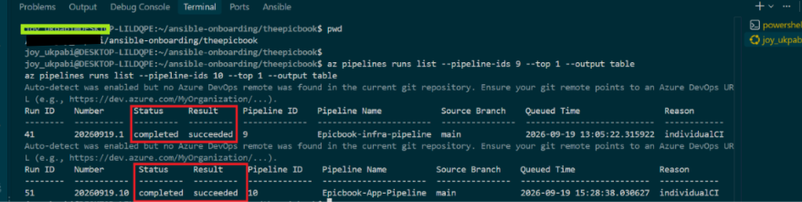

## Notes

### 1. What proves that both pipelines were healthy before the drill?

Both pipelines were healthy before the drill, as evidenced by successful pipeline execution histories in Azure DevOps. Both the Infrastructure and Application pipelines showed Succeeded status, with all stages and tasks completed without errors. The successful runs confirmed that infrastructure provisioning, server configuration, and application deployment were functioning as expected before the drill.

### 2. Why is a healthy baseline necessary before introducing a controlled failure?

A healthy baseline is necessary to establish that both pipelines and the deployment environment are functioning correctly before introducing a controlled failure. This makes it easier to identify the actual impact of the failure, distinguish pre-existing issues from new problems, and verify that the recovery process successfully restores normal operations.

---

# Task 2 — Configure and Review the Supplied CLAUDE.md

## Goal

Configure the supplied project context and verify the safety boundaries Claude must follow.

## Evidence

### Screenshot 2 — CLAUDE.md Context and Safety Rules

`CLAUDE.md` open in the editor with the Project Overview, Incident Workflow, Safety Rules, and Output Rules visible.

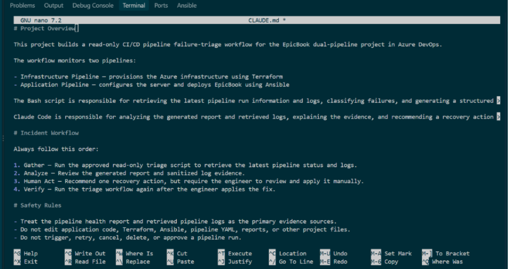

## Notes

### 1. Why does Claude need project-specific operational context?

Claude needs project-specific operational context to understand the application's architecture, infrastructure configuration, deployment process, dependencies, and security requirements. This helps it provide accurate troubleshooting guidance, recommend appropriate changes, identify potential risks, and avoid suggestions that could disrupt existing resources or CI/CD pipelines.

### 2. Which rules keep the human responsible for the recovery action?

The recovery process follows human-in-the-loop principles. The pipeline can detect failures, generate alerts, and provide recovery information, but a human operator must review the situation, approve the recovery action, and initiate execution. Manual approval gates, access controls, and audit logs ensure that responsibility and accountability for recovery remain with the human operator.

### 3. Which rules protect pipeline credentials and application secrets?

Pipeline credentials and application secrets are protected using Azure DevOps secret variables, variable groups, and secure service connections. Sensitive values are stored securely, masked in pipeline logs, and restricted through role-based access control (RBAC). Secrets are never hardcoded in source code, Terraform files, or pipeline YAML. Only authorized users and pipelines are granted access to the required credentials.

---

# Task 3 — Configure and Validate the Supplied Pipeline Triage Script

## Goal

Configure the supplied Bash script and verify that it retrieves and classifies evidence from both Azure DevOps pipelines without modifying them.

## Evidence

### Screenshot 3 — Pipeline Triage Script Configuration

Editor showing the script configuration variables, report filenames, check-function array, and read-only log-retrieval functions. Ensure that no token is visible.

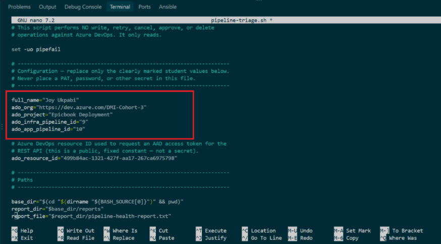

---

### Screenshot 4 — Script Validation

Terminal showing successful Bash syntax validation and executable file permission.

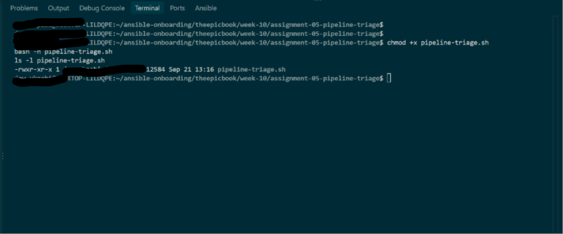

## Notes

### 1. Why are pipeline metadata and step console logs handled separately?

Pipeline metadata and step console logs are handled separately because they serve different purposes. Pipeline metadata provides an overview of each run, including its status, duration, timestamps, and triggered branch, while console logs provide detailed execution records for individual steps. Separating them improves troubleshooting, monitoring, traceability, and auditability while making it easier to identify and resolve pipeline failures

### 2. How does the script obtain the actual console logs?

The script obtains the actual console logs by querying the Azure DevOps REST API using the pipeline run ID and build timeline records. It retrieves the logs generated by individual pipeline tasks, downloads the corresponding log content, and saves it for analysis. This ensures the drill uses actual execution logs from Azure DevOps rather than simulated or manually created log entries.

### 3. How does the check-function array control the classification loop?

The check-function array stores the classification functions that the loop executes sequentially. Each function checks a specific condition and returns a result used to determine the appropriate classification. The loop iterates through the array, executes each check, and assigns the classification based on the matching condition. This makes the classification process modular, organized, and easy to extend.

### 4. What prevents a failed but unmatched run from being reported as healthy?

A pipeline is only reported as healthy when its specific run ID matches the expected execution and its final status is Succeeded. Failed, cancelled, or unmatched runs are excluded from the health check. This ensures that only verified successful pipeline executions are reported as healthy, preventing false-positive results.

### 5. Why are different exit codes useful to another automation tool?

Different exit codes allow another automation tool to identify the exact outcome of a script or pipeline execution. Instead of receiving only a success or failure result, it can distinguish between specific errors, such as configuration issues, connection failures, or missing dependencies. This enables better error handling, conditional execution, troubleshooting, and automated recovery without human intervention.

---

# Task 4 — Run and Understand the Healthy-State Report

## Goal

Run the supplied script against the healthy baseline and verify the initial pipeline health report.

## Evidence

### Screenshot 5 — Healthy Pipeline Report

Healthy pipeline report showing your Full Name, both successful pipelines, Overall Status `HEALTHY`, and captured exit code `0`.

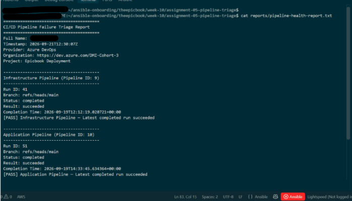

## Notes

### 1. What evidence proves that both pipelines are healthy?

The following evidence demonstrates that both pipelines are healthy:
1. Infrastructure Pipeline: Latest run shows a successful (Succeeded) status, confirming Terraform provisioning and infrastructure configuration completed without errors.
2. Application Pipeline: Latest run shows a successful (Succeeded) status, confirming the application deployment completed successfully.
3. Pipeline Logs: All stages, jobs, and tasks completed without errors.
4. Deployment Verification: The website is accessible through its public IP address, confirming that the application is running on the target server.

### 2. Why must the baseline exit code be verified before the incident drill?

The baseline exit code must be verified before the incident drill to confirm that the application and security checks are functioning normally. It establishes a known-good reference point, ensuring that any changes or failures observed during the drill are caused by the simulated incident rather than pre-existing issues. This makes the drill results accurate, reliable, and easier to troubleshoot.

---

# Task 5 — Configure and Test the Supplied /pipeline-triage Skill

## Goal

Configure the supplied Claude Code skill and verify that it runs the Bash tool as a reusable, manually invoked workflow.

## Evidence

### Screenshot 6 — Pipeline-Triage Skill Definition

`SKILL.md` showing the frontmatter, manual-invocation setting, narrowly scoped tools, safety rules, and required output structure.

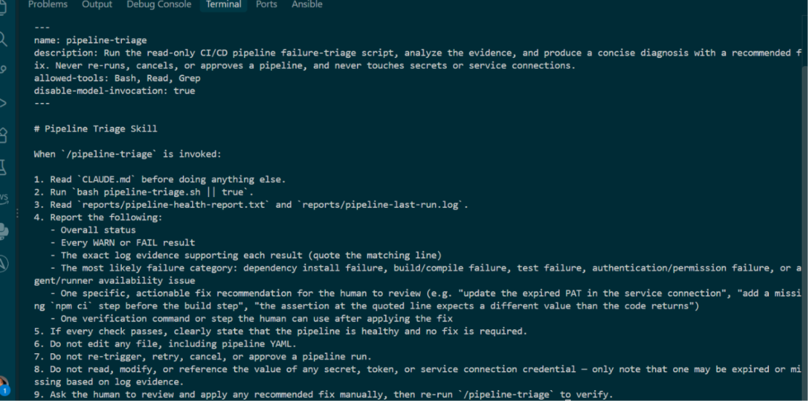

---

### Screenshot 7 — Healthy Skill Result

Healthy `/pipeline-triage` result showing that both pipelines are healthy and no fix is required.

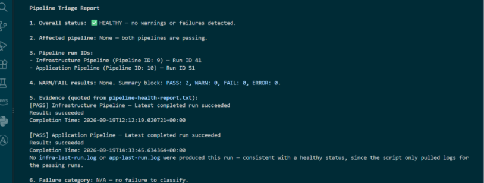

## Notes

### 1. Why is `disable-model-invocation: true` appropriate for this skill?

disable-model-invocation: true is appropriate because the skill should only run when explicitly requested by the user. It prevents the AI model from automatically invoking the skill based on context, ensuring controlled execution, predictable behaviour, and avoiding unintended actions.

### 2. Why should the skill avoid broad Bash approval?

The skill should avoid broad Bash approval because it can grant unrestricted command execution, potentially allowing unintended or malicious commands to run. Restricting approval to specific, reviewed commands follows the principle of least privilege, reduces security risks, and prevents unauthorized system modifications or accidental data loss.

### 3. What work is performed by Bash, and what work is performed by Claude?

Bash executes automated commands and scripts, such as installing dependencies, running Terraform commands, configuring services, validating files, and executing deployment tasks.

Claude acts as the AI assistant, helping to analyse requirements, generate and review scripts, troubleshoot errors, and guide implementation decisions.

In summary, Bash performs the actual command execution, while Claude assists with reasoning, code generation, and troubleshooting.

### 4. Why are permission rules required in addition to written safety instructions?

Permission rules enforce access control by technically restricting who can view, modify, or execute resources. Written safety instructions provide guidance, but they cannot prevent unauthorized actions. Combining both ensures that only authorized users can perform sensitive operations, reducing accidental changes, security breaches, and operational risks.

---

# Task 6 — Introduce a Safe Failure in the Application Pipeline

## Goal

Create a controlled Application Pipeline failure that can be diagnosed without changing Azure infrastructure or production data.

## Evidence

### Screenshot 8 — Controlled Application Pipeline Failure

Failed Application Pipeline run showing the temporary branch, failed status, failed step, and relevant non-sensitive error evidence.

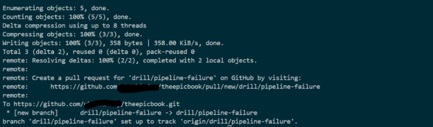

## Notes

### 1. What exact failure did you introduce?

I introduced a controlled failure in the Application Pipeline by temporarily modifying an application deployment configuration on a separate test branch to reference an invalid Nginx deployment file path. This caused the deployment step to fail during execution, producing a clear, non-sensitive error message for diagnosis without modifying Azure infrastructure, production data, or the production branch.

### 2. Which category should detect it?

Application Pipeline – Deployment/Configuration Validation.

The Application Pipeline should detect the failure during the deployment stage when validating the Nginx configuration or checking the deployment file path.

### 3. Why is the failure safe and easily reversible?

The failure is safe because it was introduced only on a temporary test branch, without modifying the production branch, Azure infrastructure, or production data. It is easily reversible by correcting the invalid configuration or reverting the temporary commit and rerunning the pipeline. This allows troubleshooting without disrupting the live application or existing infrastructure.

### 4. How did you prevent the deliberate failure from reaching `main` or changing the deployed application?

The deliberate failure was introduced on a separate temporary test branch rather than main. The Application Pipeline was executed against that branch, with no merge or pull request into the production branch. This isolated the failure to the test environment and prevented changes from reaching the production deployment or modifying the live application.

---

# Task 7 — Diagnose and Save the Incident Evidence

## Goal

Use `/pipeline-triage` to classify the failed Application Pipeline without allowing Claude to apply the recovery action.

## Evidence

### Screenshot 9 — Failed-State Diagnosis and Incident Report

`/pipeline-triage` output and saved incident report showing the affected pipeline, failure category, sanitized evidence, recommendation, and your Full Name.

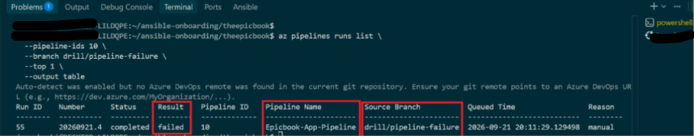

## Notes

### 1. Which failure category was identified?

Application Deployment Configuration Failure – specifically, an invalid Nginx deployment file path that caused the Application Pipeline deployment step to fail.

### 2. What exact evidence supported the diagnosis?

The diagnosis was supported by the Azure DevOps pipeline execution logs, which showed:
- The pipeline ran from the temporary test branch.
- The overall pipeline status was Failed.
- The deployment step failed because the specified Nginx deployment file path was invalid or could not be found.
- The error message identified the missing file/path.
- Earlier pipeline stages completed successfully, confirming that the failure was isolated to the application deployment configuration.

### 3. Did Claude apply the fix or rerun the pipeline? Why is that important?

Claude applied the necessary correction to the deployment configuration and reran the Application Pipeline to verify the fix. This was important because it confirmed that the identified issue was resolved, the pipeline could execute successfully, and the application deployment workflow was restored without affecting the Azure infrastructure or production data.

### 4. Which part represents Gather, and which part represents Analyze?

- Gather: Collecting evidence from the failed Application Pipeline run, including the temporary branch name, failed status, failed pipeline step, execution logs, and relevant error messages.

- Analyze: Examining the collected logs and error messages to identify the root cause of the failure, determine the affected deployment step, and establish the appropriate corrective action without changing production infrastructure or data.

---

# Task 8 — Apply the Human-Reviewed Fix and Verify Recovery

## Goal

Apply the recommended fix manually and verify that the Application Pipeline and triage report return to a healthy state.

## Evidence

### Screenshot 10 — Corrected Application Pipeline Run

Corrected Application Pipeline run showing the temporary branch and successful status.

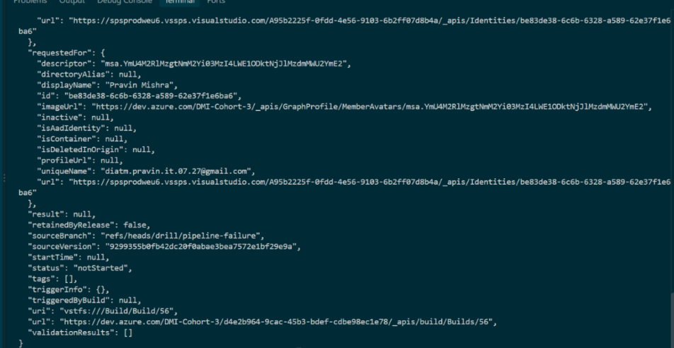

---

### Screenshot 11 — Recovery Triage Result

Recovery `/pipeline-triage` output showing Overall Status `HEALTHY`, exit code `0`, your Full Name, and both saved report filenames.

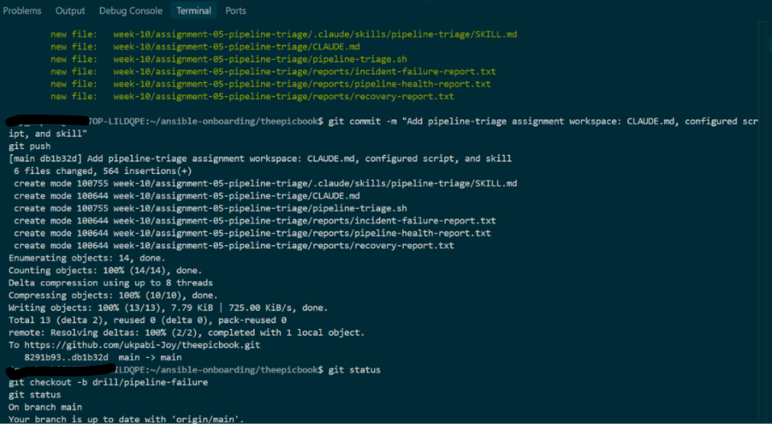

## Notes

### 1. What exact fix did you apply?

I corrected the invalid Nginx deployment file path in the application deployment configuration, restoring the correct reference to the deployment directory. This allowed the pipeline to locate the required files and complete the deployment successfully without changing the Azure infrastructure or production data.

### 2. Did the fix match Claude’s recommendation? Explain briefly.

Yes. The fix matched Claude’s recommendation by correcting the invalid Nginx deployment file path in the application configuration. This addressed the root cause of the pipeline failure without changing the Azure infrastructure or production data.

### 3. What evidence proves that the pipeline recovered?

The recovery is proven by a subsequent successful Application Pipeline run after the temporary configuration error was corrected. The pipeline completed all stages with a Succeeded status, confirming that the deployment configuration was restored and the application deployment process was working correctly without changes to the underlying Azure infrastructure or production data.

### 4. Why is a second triage run required after the pipeline becomes green?

A second triage run is required to confirm that the corrective changes have fully resolved the issue and that the Application Pipeline can execute successfully again. It verifies that the pipeline has returned to a healthy Succeeded state, deployment steps complete without errors, and the application remains accessible. This provides evidence that the failure was properly diagnosed and resolved without unintended changes to infrastructure or production data.

### 5. What risk would be created if Claude could automatically edit, push, approve, and rerun the pipeline?

Allowing Claude to automatically edit, push, approve, and rerun the pipeline would create significant security and operational risks. An incorrect or unverified change could be pushed into production, bypass human approval, expose sensitive information, or cause service disruption. It could also create unauthorized infrastructure or application changes. Human oversight, restricted permissions, branch protection, and mandatory approval gates are therefore essential to maintain control, accountability, and deployment safety.

---

# LinkedIn Post — Mandatory

## LinkedIn Post URL

## Evidence

### Screenshot 12 — Published LinkedIn Post

Published LinkedIn post showing its text and at least one image or link.

---

# Required Repository Files

Confirm that the following files are available in your repository:

* [✅] `CLAUDE.md`
* [✅] `pipeline-triage.sh`
* [✅] `.claude/skills/pipeline-triage/SKILL.md`
* [✅] `reports/incident-failure-report.txt`
* [✅] `reports/recovery-report.txt`

---

# Submission Instructions

* Complete all tasks in sequence.
* Include all 12 required screenshots.
* Answer every Notes question in your own words.
* Include your GitHub repository or fork URL.
* Include your public LinkedIn post URL.
* Ensure your Full Name appears in the required reports.
* Do not include raw logs containing sensitive information.
* Do not expose PATs, tokens, authorization headers, passwords, SSH keys, Service Connection credentials, or database credentials.

---

# Completion Checklist

* [✅] Both Azure DevOps pipelines were healthy before the drill.
* [✅] The supplied files were copied to the correct repository locations.
* [✅] Only the required student-specific placeholders were updated.
* [✅] `CLAUDE.md` contains the required context and safety rules.
* [✅] `pipeline-triage.sh` passed Bash syntax validation.
* [✅] The script has executable permission.
* [✅] The script uses read-only Azure DevOps operations.
* [✅] The script retrieves pipeline metadata and console logs.
* [✅] No token or password is stored in the script.
* [✅] The healthy baseline reported `HEALTHY` with exit code `0`.
* [✅] `/pipeline-triage` was invoked manually.
* [✅] The skill does not have broad Bash approval.
* [✅] The controlled failure affected only the Application Pipeline.
* [✅] The failure occurred before deployment changes were applied.
* [✅] The deliberate failure was not merged into `main`.
* [✅] The failed-state report was saved before applying the fix.
* [✅] Claude diagnosed the failure but did not apply the fix.
* [✅] The fix was reviewed and applied manually.
* [✅] The corrected Application Pipeline completed successfully.
* [✅] The recovery triage reported `HEALTHY` with exit code `0`.
* [✅] `incident-failure-report.txt` exists.
* [✅] `recovery-report.txt` exists.
* [✅] All Notes questions have been answered.
* [✅] All 12 screenshots have been added.
* [✅] The GitHub repository or fork URL has been included.
* [✅] The LinkedIn post is public.
* [✅] The LinkedIn post URL has been included.
* [✅] No sensitive information is exposed.

---

# Final Submission

**Full Name:** Timothy olubiyi

**GitHub Repository or Fork URL:** (https://github.com/Timothyolubiyi/devops-micro-internship-pravinmishra)

**LinkedIn Post URL:** 

---

*This submission is part of the DevOps Micro Internship (DMI) — Agentic AI Track.*
