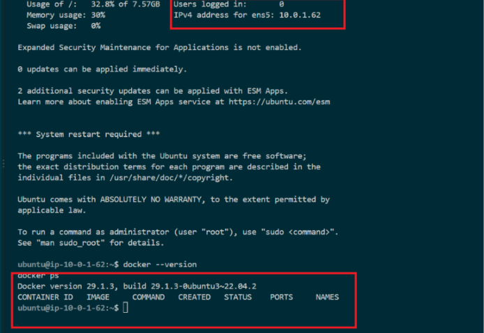
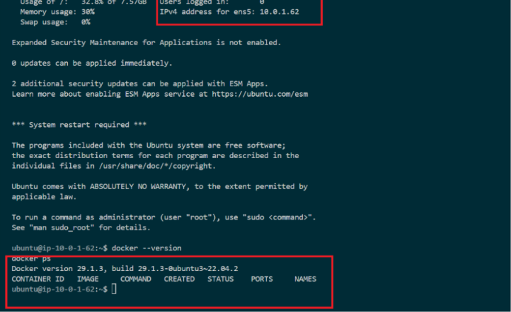
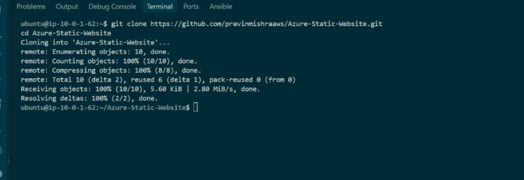
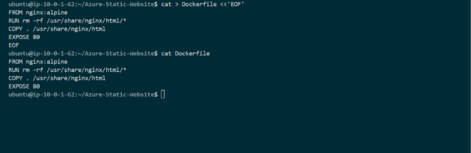
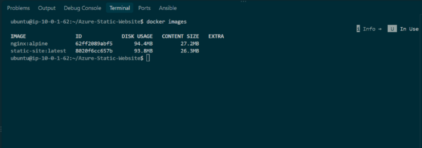
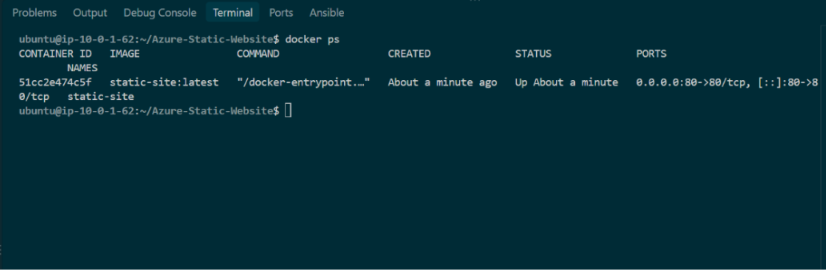
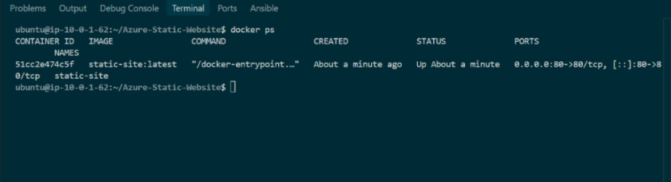
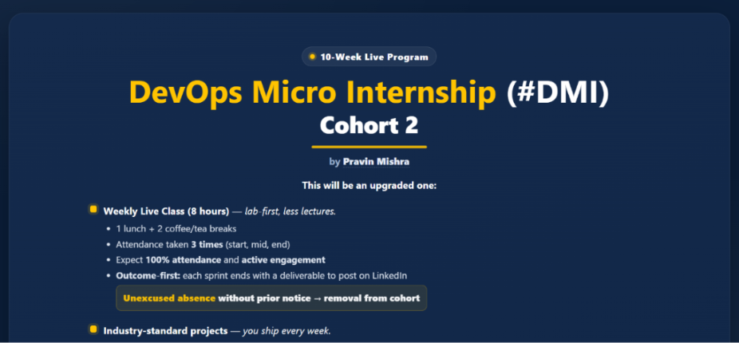

# Assignment 1 — Deploy a Static Website on a Cloud VM Using Docker

Part of the DevOps Micro Internship (DMI) with Agentic AI

---

## Purpose

In this assignment, you will provision a cloud VM (AWS or Azure), automate Docker installation using Cloud-Init, containerize a static website with Docker and Nginx, and deploy it so it's accessible through the VM's public IP.

---

# Task 1 — Launch the Cloud Virtual Machine

## Goal

Provision an Ubuntu VM on AWS or Azure with a public IP and Security Group/NSG rules allowing SSH (22) and HTTP (80).

### Evidence

#### Screenshot 1 — Cloud VM overview page showing the running VM, public IP, and security rules

---

# Task 2 — Configure Cloud-Init for Docker Installation

## Goal

Configure User Data (AWS) or Custom Data (Azure) to automatically install Docker during VM provisioning.

### Evidence

#### Screenshot 2 — Output of `cat /var/log/cloud-init-output.log` showing Docker installation activity

---

# Task 3 — Verify Docker Installation

## Goal

Connect via SSH and confirm Docker is installed and running.

### Evidence

#### Screenshot 3 — Terminal showing `docker --version` and `docker ps`

---

# Task 4 — Clone the Application Repository

## Goal

Clone `https://github.com/pravinmishraaws/Azure-Static-Website.git` and verify the project files.

### Evidence

#### Screenshot 4 — Terminal showing the project directory contents

---

# Task 5 — Create a Dockerfile

## Goal

Create a Dockerfile that serves the static site with `nginx:alpine`.

### Evidence

#### Screenshot 5 — Dockerfile contents

---

# Task 6 — Build the Docker Image

## Goal

Build the image tagged `static-site:latest`.

### Evidence

#### Screenshot 6 — Terminal showing `docker images` with the `static-site:latest` image

---

# Task 7 — Deploy the Docker Container

## Goal

Run the container mapping port 80, named `static-site`.

### Evidence

#### Screenshot 7 — Terminal showing `docker ps` displaying the running container

---

# Task 8 — Verify the Deployment

## Goal

Confirm the site is accessible through the VM's public IP in a browser.

### Evidence

#### Screenshot 8 — Terminal showing the Public IP

---

#### Screenshot 9 — Browser displaying the deployed website

---

# LinkedIn Post (Optional)

## Goal

Create a LinkedIn post describing what you deployed, the deployment process, and key learning outcomes.

## Evidence

#### LinkedIn Post URL

Paste your LinkedIn post URL here:

---

#### Screenshot — Published LinkedIn post

---

# Submission Instructions

- Add all required screenshots in your submission
- Full name must be visible in required screenshots
- Do not expose sensitive information (passwords, keys, account IDs)

---

# Completion Checklist

- [✅] Task 1: Cloud VM provisioned with required networking (Screenshot 1)
- [✅] Task 2: Docker installed via Cloud-Init (Screenshot 2)
- [✅] Task 3: Docker installation verified (Screenshot 3)
- [✅] Task 4: Application repository cloned (Screenshot 4)
- [✅] Task 5: Dockerfile created (Screenshot 5)
- [✅] Task 6: Docker image built (Screenshot 6)
- [✅] Task 7: Container deployed and running (Screenshot 7)
- [✅] Task 8: Website accessible via public IP (Screenshots 8–9)
- [✅] No sensitive information exposed

---

## 📌 About DMI & CloudAdvisory

DevOps Micro Internship (DMI) is a project-based DevOps program run by Pravin Mishra (The CloudAdvisory) focused on real-world execution, systems thinking, and career readiness.

It helps learners build strong DevOps foundations with hands-on experience.

---

## 📌 Resources

- 🌐 DMI Official Website: https://dmi.pravinmishra.com?utm_source=github&utm_medium=readme  
- 🎓 University: https://university.pravinmishra.com?utm_source=github&utm_medium=readme  
- 💬 Discord Community: https://discord.pravinmishra.com?utm_source=github&utm_medium=readme  
- 📝 Blog: https://dmi.pravinmishra.com/blog?utm_source=github&utm_medium=readme  
- ▶️ YouTube Playlist: https://www.youtube.com/playlist?list=PLFeSNDtI4Cho  
- 🔗 Pravin Mishra (LinkedIn): https://www.linkedin.com/in/pravin-mishra-aws-trainer/  
- 🏢 CloudAdvisory (LinkedIn): https://www.linkedin.com/company/thecloudadvisory/

---

*This submission is part of DevOps Micro Internship (DMI) — Agentic AI Track.*
